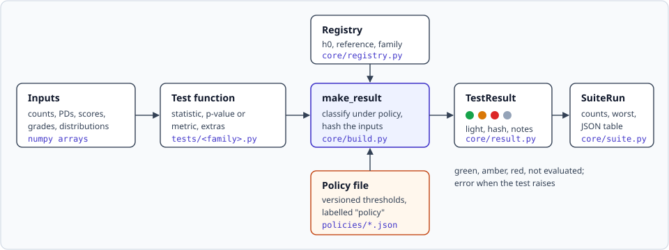

# Architecture

How a validation test becomes evidence: a statistic computed from the caller's inputs, classified under a named
policy, recorded with its source and a fingerprint of what was tested.

| Page | Topic |
|---|---|
| [01_result-contract.md](architecture/01_result-contract.md) | the `TestResult` record and why each field exists |
| [02_policy-and-lights.md](architecture/02_policy-and-lights.md) | thresholds as policy, the three threshold kinds, what the literature says about conventional bands |
| [03_suite-and-reproducibility.md](architecture/03_suite-and-reproducibility.md) | running a battery, error handling, inputs hashing, the Pyodide lane |
