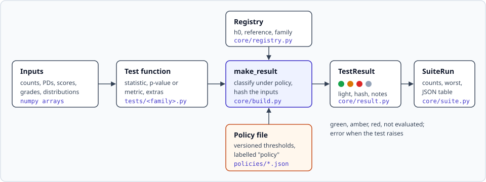

# U0 core contracts, design

## Modules

| Module | Responsibility |
|---|---|
| `core/result.py` | `Light` and the immutable `TestResult`; validation of required fields; JSON-safe export. |
| `core/policy.py` | `Threshold` (three kinds) and `Policy`; loading from JSON; the packaged default policy. |
| `core/registry.py` | the `register` decorator and the catalogue of `TestSpec` records. |
| `core/hashing.py` | the canonical SHA-256 of test inputs. |
| `core/build.py` | `make_result`: looks up the test's spec, classifies under the policy, hashes inputs. |
| `core/suite.py` | `run_suite`: runs `(function, kwargs)` tasks with a shared policy, model id and segment. |

## Data flow

A test function computes its statistic and p-value (or metric) from NumPy inputs, then calls `make_result`,
which reads the null hypothesis and reference from the registry, asks the policy for a light, and hashes the
inputs. The suite injects the policy, model id and segment into each task, converts any exception into an
`ERROR` result, and returns a `SuiteRun` with counts per light, the worst light and a JSON-safe table.

## Interfaces

- `make_result(test_id, *, statistic=None, p_value=None, metric=None, policy=None, ...) -> TestResult`
- `run_suite(tasks, *, policy=None, model_id=None, segment=None) -> SuiteRun`
- `Policy.classify(test_id, *, p_value=None, metric=None) -> (Light, Threshold | None)`
- `default_policy()`, `load_policy(path)`, `catalogue(family=None)`
