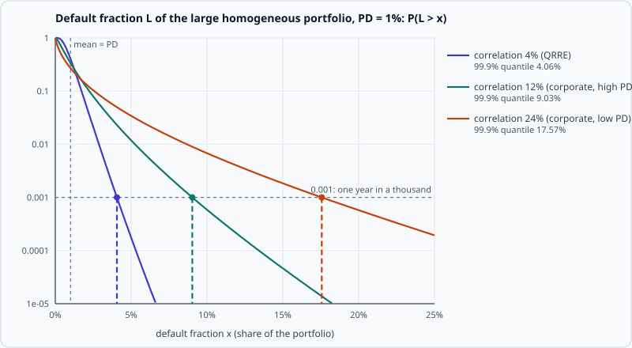

# 01. The one-factor model and the large homogeneous portfolio

`riskvalidation.engines.vasicek`

The one-factor (Vasicek) model is the frame under the IRB risk-weight functions, the Vasicek-corrected calibration
tests, the correlated most prudent bounds and the point-in-time decomposition of a through-the-cycle PD. It is small
enough to state completely, and its limit, the large homogeneous portfolio (LHP), has a closed-form loss distribution.

## 1. The model

Obligor $i$ has a standardised asset return

$$A_i = \sqrt{\rho}\,Z + \sqrt{1 - \rho}\,\varepsilon_i, \qquad Z, \varepsilon_1, \varepsilon_2, \dots \ \text{independent standard normal},$$

and defaults when $A_i < \Phi^{-1}(\mathrm{PD})$, so its unconditional default probability is the PD. $Z$ is the
systematic factor (a low $Z$ is a bad year), $\rho$ the asset correlation. Given $Z = z$ defaults are independent with

$$p(z) = \Phi\!\left(\frac{\Phi^{-1}(\mathrm{PD}) - \sqrt{\rho}\,z}{\sqrt{1 - \rho}}\right).$$

In an infinitely granular portfolio of such obligors the default fraction $L$ converges to $p(Z)$ (Vasicek 1991; Gordy
2003), and because $p$ is decreasing in $z$,

$$\Pr[L \le x] = \Phi\!\left(\frac{\sqrt{1 - \rho}\,\Phi^{-1}(x) - \Phi^{-1}(\mathrm{PD})}{\sqrt{\rho}}\right), \qquad
q\text{-quantile} = \Phi\!\left(\frac{\Phi^{-1}(\mathrm{PD}) + \sqrt{\rho}\,\Phi^{-1}(q)}{\sqrt{1 - \rho}}\right),$$

with density, for $0 < x < 1$ and $g = \Phi^{-1}(x)$,

$$f(x) = \sqrt{\frac{1 - \rho}{\rho}}\,\exp\!\left(\frac{g^2}{2} - \frac{\big(\sqrt{1 - \rho}\,g - \Phi^{-1}(\mathrm{PD})\big)^2}{2\rho}\right),$$

and mean $\mathrm{E}[L] = \mathrm{PD}$.

## 2. The IRB formula is a quantile of this distribution

The IRB capital requirement charges the loss at the 99.9% quantile of the systematic factor, less the expected loss
(BCBS, *An Explanatory Note on the Basel II IRB Risk Weight Functions*, July 2005,
[bis.org](https://www.bis.org/publications/explanatory-note-basel-ii-irb-risk-weight-functions.pdf)):

$$K = \mathrm{LGD}\cdot\Phi\!\left(\frac{\Phi^{-1}(\mathrm{PD}) + \sqrt{R}\,\Phi^{-1}(0.999)}{\sqrt{1 - R}}\right) - \mathrm{PD}\cdot\mathrm{LGD}$$

for retail classes (with a maturity adjustment for the others). The first term is LGD times the 99.9% quantile of the
LHP default fraction at correlation $R$; `test_lhp_identities` checks that $K/\mathrm{LGD} + \mathrm{PD}$ of the mortgage
function equals `lhp_quantile(0.999, PD, 0.15)` to machine precision. Gordy (2003) shows why the regulator chose this
model: capital that depends only on each exposure's own parameters (portfolio invariance) is essentially obtainable only
from an asymptotic single risk factor model, which is why the framework is calibrated to a well-diversified bank and
leaves concentration to Pillar 2. The figure above shows the PD 1% case at correlations 4% (QRRE), 12% and 24% (the
corporate function's bounds): the 99.9% quantiles are 4.06%, 9.03% and 17.57%.

## 3. The implied factor: the state of the cycle

An observed default rate $\mathrm{DR}_t$ of a segment whose through-the-cycle PD is $\overline{\mathrm{PD}}$ implies the
systematic factor at which the conditional PD equals it, the inverse of $p(z)$:

$$\hat z_t = \frac{\Phi^{-1}(\overline{\mathrm{PD}}) - \sqrt{1 - \rho}\,\Phi^{-1}(\mathrm{DR}_t)}{\sqrt{\rho}}.$$

$\hat z_t$ is a credit-cycle index: negative in bad years, positive in good ones. It is the single systematic factor of
the Z-factor representation of rating transitions (documented with the transition estimators) and the link between a point-in-time and a through-the-cycle PD: in this
frame the point-in-time PD in cycle state $z_t$ is $p(z_t)$ and the through-the-cycle PD is its average over the cycle
(Carlehed and Petrov 2012, [doi:10.21314/jrmv.2012.091](https://doi.org/10.21314/jrmv.2012.091), define a degree of
point-in-time-ness on this basis; their parameterisation is not implemented).

## 4. Functions

| Function | Returns |
|---|---|
| `conditional_pd(pd, rho, z)` | $p(z)$, vectorised in $z$ |
| `lhp_cdf(x, pd, rho)`, `lhp_quantile(q, pd, rho)`, `lhp_pdf(x, pd, rho)` | the LHP distribution, quantile and density |
| `implied_factor(default_rate, pd, rho)` | $\hat z_t$ |

`test_lhp_identities` checks that the quantile inverts the distribution, that it equals the conditional PD at the
stressed factor $z = -\Phi^{-1}(q)$, that the implied factor inverts the conditional PD, that the density integrates to
the PD as its mean, and the IRB identity above.

## 5. What the model leaves out

The LHP is the limit of a portfolio with infinitely many small, identical exposures and one systematic factor. A real
portfolio has name concentration (a granularity adjustment), sector concentration (several factors), random LGDs
correlated with defaults, and a finite horizon. The IRB formula ignores all of these by design; a credit portfolio
model, and the economic perspective of the ICAAP, must not.

## References

- Vasicek, O.A. (1987). Probability of loss on loan portfolio. Reprinted in *Finance, Economics and Mathematics*,
  Wiley, 2015, 143-146. [doi:10.1002/9781119186229.ch17](https://doi.org/10.1002/9781119186229.ch17).
- Vasicek, O.A. (1991). Limiting loan loss probability distribution. Reprinted ibid., 147-148.
  [doi:10.1002/9781119186229.ch18](https://doi.org/10.1002/9781119186229.ch18).
- Vasicek, O.A. (2002). Loan portfolio value. *Risk*, December 2002, 160-162. Reprinted ibid., 149-160.
  [doi:10.1002/9781119186229.ch19](https://doi.org/10.1002/9781119186229.ch19).
- Gordy, M.B. (2003). A risk-factor model foundation for ratings-based bank capital rules. *Journal of Financial
  Intermediation* 12(3):199-232. [doi:10.1016/S1042-9573(03)00040-8](https://doi.org/10.1016/S1042-9573(03)00040-8).
- BCBS (2005). An explanatory note on the Basel II IRB risk weight functions.
  [bis.org](https://www.bis.org/publications/explanatory-note-basel-ii-irb-risk-weight-functions.pdf).
- Carlehed, M. and Petrov, A. (2012). A methodology for point-in-time-through-the-cycle probability of default
  decomposition in risk classification systems. *Journal of Risk Model Validation* 6(3):3-25.
  [doi:10.21314/jrmv.2012.091](https://doi.org/10.21314/jrmv.2012.091).
