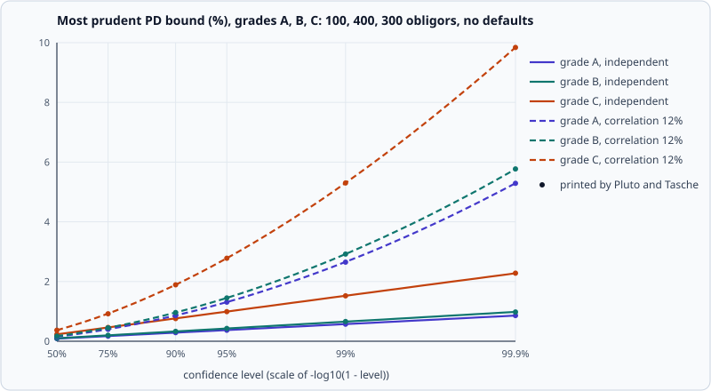

# 02. Low-default portfolios: most prudent estimation

`riskvalidation.engines.low_default`

Some portfolios (sovereigns, banks, large corporates, specialised lending) have so few defaults that a grade's observed
default rate is zero, or nearly so, for years. A PD of zero is not credible and the IRB framework floors it, but a
validator still needs an estimate that uses the information the portfolio has: how many obligors were observed without
defaulting, and the ordering of the grades. Pluto and Tasche, *Estimating probabilities of default for low default
portfolios* ([arXiv:cond-mat/0411699](https://arxiv.org/abs/cond-mat/0411699), 2004, revised 2005; book chapter in
Engelmann and Rauhmeier (eds.), *The Basel II Risk Parameters*, Springer 2006,
[doi:10.1007/3-540-33087-9_5](https://doi.org/10.1007/3-540-33087-9_5)), estimate each grade's PD as an upper confidence
bound under the most prudent assumption compatible with the ordering.

## 1. The principle

Grades are ordered best first, $A, B, C, \dots$, and the ordering is assumed right: $p_A \le p_B \le p_C$. For grade
$A$ the most prudent assumption is that it is as risky as everything below it, $p_A = p_B = p_C$, so the obligors and
defaults of $A$, $B$ and $C$ are pooled; for $B$ the pool is $B$ and $C$; for $C$ it is $C$ alone. The bound for a grade
is the upper confidence bound at level $\gamma$ of a binomial proportion from its pool, so the bounds are monotone by
construction.

**No defaults, independent obligors** (equations 2.2b, 2.4b, 2.5b), with $n_A$, $n_B$, $n_C$ obligors:

$$\hat p_A = 1 - (1 - \gamma)^{1/(n_A + n_B + n_C)}, \qquad \hat p_B = 1 - (1 - \gamma)^{1/(n_B + n_C)}, \qquad \hat p_C = 1 - (1 - \gamma)^{1/n_C}.$$

**A few defaults** (section 3, equation 3.2): with $N$ pooled obligors and $D$ pooled defaults, the bound is the smallest
$p$ at which observing at most $D$ defaults has probability $1 - \gamma$,

$$1 - \gamma = \sum_{i=0}^{D} \binom{N}{i}\, p^i (1 - p)^{N - i},$$

the Clopper-Pearson upper bound, computed as the $\gamma$-quantile of $\mathrm{Beta}(D + 1, N - D)$.

**Correlated defaults** (section 4, equation 4.1): in the one-factor model of the [Vasicek page](01_vasicek-lhp.md),
obligor $i$ defaults when $\sqrt{\rho}\,Y + \sqrt{1 - \rho}\,\xi_i$ falls below $\Phi^{-1}(p)$. Conditional on the
systematic factor $Y = y$ defaults are independent with PD $p(y) = \Phi\big((\Phi^{-1}(p) - \sqrt{\rho}\,y)/\sqrt{1 - \rho}\big)$,
and the bound solves

$$1 - \gamma = \int_{-\infty}^{\infty} \varphi(y)\, \Pr\big[\mathrm{Bin}(N, p(y)) \le D\big]\, dy,$$

which for no defaults is the paper's
$1 - \gamma = \int \varphi(y)\,\big(1 - p(y)\big)^{N}\,dy$. Correlation widens the bound: the zero-default observation
is less informative when defaults cluster.

## 2. Implementation

`most_prudent_pd(obligors, defaults, gamma, rho=0.0)` takes the grade counts best first and returns the bounds with the
pooled obligors and defaults each bound rests on. The independent bound is the Beta quantile (SciPy). The correlated
integral is computed by Gauss-Hermite quadrature with 256 nodes (probabilists' Hermite polynomials,
`numpy.polynomial.hermite_e`), inside a bracketed root search on $p$ (Brent's method, relative tolerance $10^{-12}$).
The confidence level is the caller's: the paper notes its choice is arbitrary and that levels below 95% "seem more
appropriate" for the most prudent estimate.

## 3. Reproduction of the published tables

The paper's example has three grades with $n_A = 100$, $n_B = 400$, $n_C = 300$ obligors, at six confidence levels.
`test_pluto_tasche_tables` checks every printed cell (percent, two decimals):

| $\gamma$ | 50% | 75% | 90% | 95% | 99% | 99.9% |
|---|---|---|---|---|---|---|
| $\hat p_A$, no defaults, independent (Table 1) | 0.09 | 0.17 | 0.29 | 0.37 | 0.57 | 0.86 |
| $\hat p_B$, no defaults, independent (Table 2) | 0.10 | 0.20 | 0.33 | 0.43 | 0.66 | 0.98 |
| $\hat p_C$, no defaults, independent (Table 3) | 0.23 | 0.46 | 0.76 | 0.99 | 1.52 | 2.28 |
| $\hat p_A$, defaults 0, 2, 1 in A, B, C (Table 4) | 0.46 | 0.65 (exact 0.638) | 0.83 | 0.97 | 1.25 | 1.62 |
| $\hat p_B$, defaults 0, 2, 1 (Table 5) | 0.52 | 0.73 | 0.95 | 1.10 | 1.43 | 1.85 |
| $\hat p_C$, defaults 0, 2, 1 (Table 6) | 0.56 | 0.90 | 1.29 | 1.57 | 2.19 | 3.04 |
| $\hat p_A$, no defaults, $\rho = 12\%$ (Table 7) | 0.15 | 0.40 | 0.86 | 1.31 | 2.65 | 5.29 |
| $\hat p_B$, no defaults, $\rho = 12\%$ (Table 7) | 0.17 | 0.45 | 0.96 | 1.45 | 2.92 | 5.77 |
| $\hat p_C$, no defaults, $\rho = 12\%$ (Table 7) | 0.37 | 0.92 | 1.89 | 2.78 | 5.30 | 9.84 |

- **Independent bounds**: 35 of the 36 cells (Tables 1 to 6) are reproduced exactly at the printed precision; the 36th
  is a misprint.
- **One misprint.** Table 4 prints 0.65% for grade A at $\gamma = 75\%$ with the pool of 800 obligors and 3 defaults. The
  exact Clopper-Pearson bound is 0.638%, since $\Pr[\mathrm{Bin}(800, 0.65\%) \le 3] = 0.237$, not 0.25: 0.65% is the bound
  at $\gamma = 76.3\%$. The test asserts the exact value (0.64% at two decimals) and records the misprint.
- **Correlated bounds**: 15 of the 18 cells are identical at two decimals; three sit at a rounding boundary and differ
  by one unit (C at 75%: 0.9252%; A at 99%: 2.6563%; B at 99.9%: 5.7650%), at most 0.0063 percentage points from the
  printed value. The paper computes the integral numerically too; the tolerance is one unit of the printed precision.

## 4. Reading the bounds

- The bounds are conservative by design: they answer "how high could the PD be, given what was observed", not "what is
  the PD". Use them as an upper reference for a model's grade PDs, alongside the regulatory floor.
- They depend on the confidence level, the ordering assumption and the asset correlation, all of which must be stated
  with the result; the function returns each of them.
- The paper also extends the method to several periods and discusses scaling the bounds to a portfolio's central
  tendency; neither is implemented here. Bayesian estimation with an informative prior is the usual alternative
  (Kiefer 2006, OCC working paper 2006-2,
  [occ.gov](https://www.occ.gov/publications-and-resources/publications/economics/working-papers-archived/pub-econ-working-paper-2006-2.pdf);
  not reviewed for this page).

## References

- Pluto, K. and Tasche, D. (2005). Estimating probabilities of default for low default portfolios.
  [arXiv:cond-mat/0411699](https://arxiv.org/abs/cond-mat/0411699). In Engelmann, B. and Rauhmeier, R. (eds.), *The
  Basel II Risk Parameters*, Springer, 2006, [doi:10.1007/3-540-33087-9_5](https://doi.org/10.1007/3-540-33087-9_5);
  2nd edition 2011, [doi:10.1007/978-3-642-16114-8_5](https://doi.org/10.1007/978-3-642-16114-8_5).
- Clopper, C.J. and Pearson, E.S. (1934). The use of confidence or fiducial limits illustrated in the case of the
  binomial. *Biometrika* 26(4):404-413. [doi:10.1093/biomet/26.4.404](https://doi.org/10.1093/biomet/26.4.404).
- Kiefer, N.M. (2006). Default estimation for low-default portfolios. OCC Economics working paper 2006-2,
  [occ.gov](https://www.occ.gov/publications-and-resources/publications/economics/working-papers-archived/pub-econ-working-paper-2006-2.pdf).
