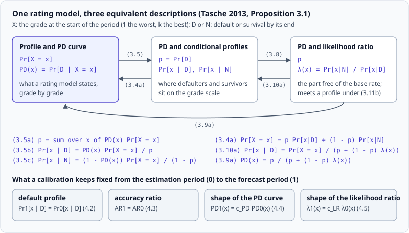
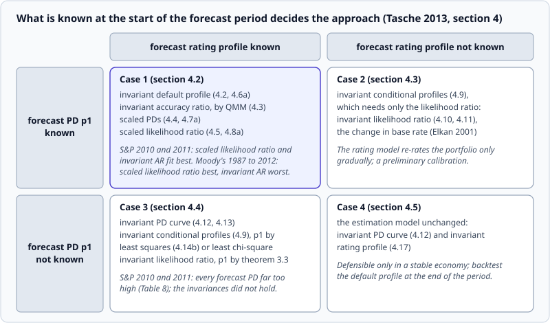
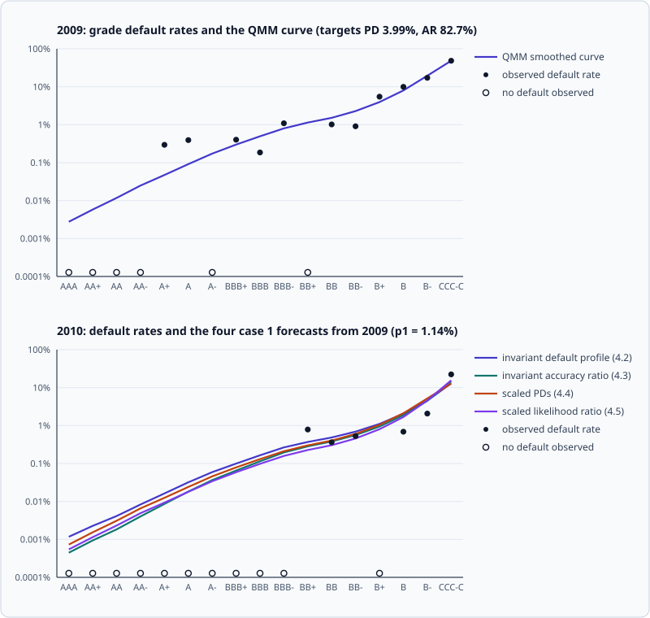

# 03. PD curve calibration

`riskvalidation.engines.pd_curve`

A rating model assigns each grade a PD. Calibrating its PD curve means forecasting the default rates of the grades in
a period other than the one the model was estimated on: a new year, a through-the-cycle target, a stress scenario.
Tasche (2013), *The art of probability-of-default curve calibration* (Journal of Credit Risk 9(4):63-103,
[doi:10.21314/jcr.2013.169](https://doi.org/10.21314/jcr.2013.169), [arXiv:1212.3716](https://arxiv.org/abs/1212.3716)),
treats it as that forecasting problem: what is known at the start of the forecast period decides which part of the
estimated model can be kept, and each choice is an invariance assumption that can be tested afterwards. The module
implements every approach of the paper, its smoothing method (quasi moment matching) and the goodness-of-fit tests the
paper uses, and reproduces the paper's S&P example from the raw counts.



## 1. The model

Grades are $x = 1, \dots, k$ in the paper's numbering, 1 the least creditworthy. (The package's functions take and
return grades **best first**, as the paper's tables list them, and reverse internally.) A borrower's grade $X$ at the
start of the period and its state at the end, default $D$ or survival $N$, have a joint distribution. Proposition 3.1
gives three equivalent ways to fix it:

1. the unconditional rating profile $\Pr[X = x]$ and the PD curve $\Pr[D \mid X = x]$;
2. the unconditional PD $p = \Pr[D]$ and the conditional profiles $\Pr[X = x \mid D]$, $\Pr[X = x \mid N]$;
3. $p$ and the likelihood ratio $\lambda(x) = \Pr[X = x \mid N] / \Pr[X = x \mid D]$ (3.8).

They are linked by the law of total probability and Bayes' formula:

$$\Pr[X = x] = p\,\Pr[X = x \mid D] + (1 - p)\,\Pr[X = x \mid N] \quad (3.4a), \qquad p = \sum_{x=1}^{k} \Pr[D \mid X = x]\,\Pr[X = x] \quad (3.5a),$$

$$\Pr[X = x \mid D] = \frac{\Pr[D \mid X = x]\,\Pr[X = x]}{p} \quad (3.5b), \qquad \Pr[X = x \mid N] = \frac{(1 - \Pr[D \mid X = x])\,\Pr[X = x]}{1 - p} \quad (3.5c),$$

$$\Pr[D \mid X = x] = \frac{p}{p + (1 - p)\,\lambda(x)} \quad (3.9a), \qquad \lambda(x) = \frac{1 - \Pr[D \mid X = x]}{\Pr[D \mid X = x]}\,\frac{p}{1 - p} \quad (3.9b).$$

The discriminatory power is the accuracy ratio, from the conditional profiles

$$\mathrm{AR} = \sum_{x=2}^{k} \Pr[X = x \mid N]\,\Pr[X \le x - 1 \mid D] - \sum_{x=1}^{k-1} \Pr[X = x \mid N]\,\Pr[X \ge x + 1 \mid D] \quad (3.7),$$

or, equivalently, from the PD curve and the profile (A.11b, with $p$ from 3.5a):

$$\mathrm{AR} = \frac{1}{p(1-p)}\Big(2\sum_{x=1}^{k}\big(1 - \Pr[D \mid x]\big)\Pr[X = x]\sum_{t=1}^{x-1}\Pr[D \mid t]\Pr[X = t] + \sum_{x=1}^{k}\Pr[D \mid x]\big(1 - \Pr[D \mid x]\big)\Pr[X = x]^2\Big) - 1.$$

**Theorem 3.3.** A profile and a likelihood ratio do not always make a model. For a non-constant $\lambda$, the equation

$$1 = \sum_{x=1}^{k} \frac{\Pr[X = x]}{p + (1 - p)\,\lambda(x)} \quad (3.11a)$$

has a solution $p \in [0, 1)$ if and only if $\sum_x \Pr[X = x]/\lambda(x) \ge 1$ and $\sum_x \Pr[X = x]\,\lambda(x) > 1$
(3.11b); the solution is unique, and it is $0$ exactly when the first sum equals 1 (3.11c). A profile and a PD curve,
on the other hand, always make a proper model (Proposition 3.1).

| Function | Equation |
|---|---|
| `model_from_counts(obligors, defaults)` | the empirical model of one period: profile, grade default rates, $p$, conditional profiles, AR by (3.7) |
| `unconditional_pd`, `implied_default_profile`, `implied_survival_profile` | (3.5a), (3.5b), (3.5c) |
| `accuracy_ratio(default_profile, survival_profile)`, `accuracy_ratio_from_curve(pd_curve, profile)` | (3.7), (A.11b) |
| `likelihood_ratio(pd_curve, pd)`, `pd_curve_from_likelihood_ratio(likelihood, pd)` | (3.9b), (3.9a) |
| `pd_from_likelihood_ratio(profile, likelihood)` | theorem 3.3: the unique root of (3.11a), or `ImproperModel` when (3.11b) fails |

The test `test_model_identities` checks every identity on the S&P data below, and checks that the empirical models
reproduce the paper's Tables 2, 3 and 4 (the 2009 unconditional default rate 3.99% and accuracy ratio 82.7%).

## 2. Smoothing a PD curve: quasi moment matching

Observed grade default rates are noisy and, in good grades, often zero. The paper smooths them with quasi moment
matching (QMM, Tasche 2009, [arXiv:0905.3928](https://arxiv.org/abs/0905.3928), section 5.2), motivated by the
binormal model of appendix A.1: if scores of defaulters and survivors are normal with common variance $\sigma^2$ and means
$\mu_D < \mu_N$, the PD curve is logistic in the score,

$$\Pr[D \mid X = x] = \frac{1}{1 + \exp(\alpha + \beta x)}, \qquad \alpha = \frac{\mu_D^2 - \mu_N^2}{2\sigma^2} + \log\frac{1 - p}{p}, \qquad \beta = \frac{\mu_N - \mu_D}{\sigma^2} \quad (A.2b\text{ to }A.2d),$$

and $\mathrm{AR} = 2\,\Phi\big((\mu_N - \mu_D)/(\sqrt{2}\,\sigma)\big) - 1$ (A.4b). The level of the curve is driven by $p$, its
steepness by the AR (A.7). For grades, which are not normal, the robust version transforms the grade first (A.8, A.9):

$$\Pr[D \mid X = x] \approx \frac{1}{1 + \exp\big(\alpha + \beta\,\Phi^{-1}(\tilde F_N(x))\big)}, \qquad \tilde F_N(x) = \frac{\Pr[X < x \mid N] + \Pr[X \le x \mid N]}{2}.$$

The average of the distribution function and its left-continuous version keeps $\tilde F_N(x) < 1$ in the best grade,
where $F_N(k) = 1$ would force a PD of zero. QMM is then five steps (appendix A.2):

1. fix the targets $p_{\text{target}}$ and $\mathrm{AR}_{\text{target}}$;
2. put them on the left of (3.5a) and (A.11b);
3. represent the PD curve by (A.8), with $\tilde F_N$ from (3.5c) on the empirical profile, grade default rates and
   unconditional default rate;
4. start from the binormal values: with $\mu = \mathrm{E}[\Phi^{-1}(\tilde F_N(X))]$ and
   $\tau^2 = \mathrm{var}[\Phi^{-1}(\tilde F_N(X))]$, $c = \sqrt{2}\,\Phi^{-1}((\mathrm{AR} + 1)/2)$,
   $\sigma^2 = \tau^2/(1 + p(1-p)c^2)$, $\mu_N = \mu + p\sigma c$, $\mu_D = \mu - (1-p)\sigma c$ (A.6), then (A.2c, A.2d);
5. solve the two equations for $\alpha$ and $\beta$.

**How step 5 is solved here.** `qmm` solves the two equations as nested bracketed roots rather than by a Newton step
from the binormal values. For a slope $\beta$ the unconditional PD falls strictly as $\alpha$ grows, so (3.5a) has one
root $\alpha(\beta)$; along $\alpha(\beta)$ the accuracy ratio rises from 0 at $\beta = 0$ towards the largest value the
grade scale and profile allow. Both roots are bracketed, around the binormal values, and found by Brent's method to
machine precision, so the solver converges whenever a solution exists and says so (`ImproperModel`) when the target AR
cannot be reached on the grade scale. The binormal values are returned as `start` for the record; on the S&P 2009 data
they are $(\alpha, \beta) = (5.022, 2.005)$ against the solution $(5.2048, 2.1613)$.

### Reproduction: Tables 5, 6 and 9

From the S&P 2009 counts (Table 2) with the exact targets $p = 234/5860 = 3.9932\%$ and $\mathrm{AR} = 82.710\%$:

| Grade | AAA | AA+ | AA | AA- | A+ | A | A- | BBB+ | BBB | BBB- | BB+ | BB | BB- | B+ | B | B- | CCC-C |
|---|---|---|---|---|---|---|---|---|---|---|---|---|---|---|---|---|---|
| default rate 2009 (%) | 0 | 0 | 0 | 0 | 0.294 | 0.392 | 0 | 0.402 | 0.185 | 1.089 | 0 | 1.017 | 0.907 | 5.479 | 9.959 | 17.162 | 48.421 |
| Table 5, smoothed (%) | 0.003 | 0.006 | 0.012 | 0.025 | 0.047 | 0.091 | 0.173 | 0.299 | 0.495 | 0.797 | 1.138 | 1.518 | 2.280 | 3.943 | 7.999 | 19.557 | 48.355 |
| `qmm` (%) | 0.0028 | 0.0058 | 0.0118 | 0.0249 | 0.0472 | 0.0913 | 0.1732 | 0.2987 | 0.4947 | 0.7975 | 1.1379 | 1.5186 | 2.2800 | 3.9429 | 7.9992 | 19.5569 | 48.3537 |

Rounded to the printed three decimals, 15 of the 17 cells are identical and two (BB, CCC-C) sit one unit off. The
implied default profile (3.5b) matches Table 6 within one unit of its fourth decimal plus 0.01% of the value. The
test `test_qmm_table5` gates both.

Table 9 prints the smoothed likelihood ratios of the paper's own QMM fits for 2009, 2010 and 2011. Recomputed, they
agree within 0.2% of the value, and the remaining gap has an exact structure: $\log\lambda(x) = \alpha + \beta\,z(x) +
\log(p/(1-p))$ with $z(x) = \Phi^{-1}(\tilde F_N(x))$, so a different $(\alpha, \beta)$ moves $\log \lambda$ by an affine
function of the scores. On the cells printed with five or more digits, $\log(\lambda_{\text{paper}}/\lambda_{\text{here}})$
is affine in $z$ to within $2\cdot10^{-5}$, with offsets in $\alpha$ and $\beta$ between $5\cdot10^{-5}$ and
$8\cdot10^{-4}$. The paper's solutions therefore sit at a slightly different point than the exact root (a solver
tolerance; the paper does not state one), while the grade scores, the logistic form and the targets are the same. This
offset, of relative size up to $10^{-4}$ in the mid grades, is also why the forecasts of section 5 below differ from the
paper in the last printed digit.

## 3. Calibrating to a forecast period

Subscript 0 marks the estimation period, subscript 1 the forecast period. Section 4 of the paper separates four cases by
what is known when the forecast is made:



### Case 1: the forecast profile $\Pr_1[X = x]$ and the forecast PD $p_1$ are known (section 4.2)

**Invariant default profile** (4.2), $\Pr_1[X = x \mid D] = \Pr_0[X = x \mid D]$. By Proposition 3.2 this gives a proper
model if and only if, for every grade,

$$p_1\,\Pr_0[X = x \mid D] \le \Pr_1[X = x] \quad\text{and}\quad p_1\big(1 - \Pr_0[X = x \mid D]\big) \le 1 - \Pr_1[X = x] \quad (4.6a),$$

and then the PD curve would be $\Pr_1[D \mid X = x] = p_1 \Pr_0[X = x \mid D] / \Pr_1[X = x]$ (4.6b). The paper implements
the assumption as its approach (ii) of section 4.2.1, which always gives a monotone curve: the observed estimation
default profile and the forecast profile give a raw survival profile by (3.5c), the two profiles give a forecast AR by
(3.7), and QMM fits the forecast curve to $p_1$ and that AR, with $\tilde F_N$ from the raw survival profile.
`invariant_default_profile` does exactly this, refuses inputs that violate (4.6a), and returns the forecast AR it used.

**Invariant accuracy ratio** (4.3), $\mathrm{AR}_1 = \mathrm{AR}_0$. QMM to $p_1$ and $\mathrm{AR}_0$. QMM needs the
survival profile, which "cannot be observed or implied at this stage"; the paper approximates it by the forecast
unconditional profile and notes the approximation "could be poor if the forecast period unconditional default rate is
high" (sections 4.2.2 and 4.2.5). `invariant_accuracy_ratio` uses that approximation.

**Scaled PDs** (4.4), $\Pr_1[D \mid X = x] = c_{PD}\,\Pr_0[D \mid X = x]$, the popular approach (the paper cites Moody's
RiskCalc methodology for it), with

$$c_{PD} = \frac{p_1}{\sum_{x} \Pr_0[D \mid X = x]\,\Pr_1[X = x]} \quad (4.7a).$$

The model is improper when a scaled PD exceeds one (section 4.2.3); `scaled_pds` refuses it. Section 4.1 explains why
the approach is questionable: by (3.4b) the scaled curve "strongly depends on the estimation period unconditional PD",
which "contaminates" the forecast.

**Scaled likelihood ratio** (4.5), $\lambda_1(x) = c_{LR}\,\lambda_0(x)$, with $c_{LR}$ the root of

$$1 = \sum_{x} \frac{\Pr_1[X = x]}{p_1 + (1 - p_1)\,c_{LR}\,\lambda_0(x)} \quad (4.8a), \qquad \frac{1}{\sum_x \Pr_1[X = x]\,\lambda_0(x)} < c_{LR} < \sum_x \frac{\Pr_1[X = x]}{\lambda_0(x)} \quad (4.8b),$$

and then $\Pr_1[D \mid X = x] = p_1 / (p_1 + (1 - p_1)\,c_{LR}\,\lambda_0(x))$ (4.8d). The right-hand side of (4.8a) falls
from $1/p_1 > 1$ to 0 as $c_{LR}$ grows, so the root always exists and is unique, and by Proposition 3.4 the model is
always proper (section 4.2.4). `scaled_likelihood_ratio` brackets the root beyond (4.8b), so it never fails, and returns
the bracket so a caller can see that the root lies inside it.

### Case 2: only the forecast PD is known (section 4.3)

Without the forecast profile only invariant conditional profiles (4.9) specify a full model, and for the PD curve alone
the invariant likelihood ratio (4.10) is enough:

$$\Pr_1[D \mid X = x] = \frac{p_1}{p_1 + (1 - p_1)\,\lambda_0(x)} \quad (4.11),$$

the "change in base rate" theorem (Elkan 2001, theorem 2): every grade's odds move by the same factor, the ratio of the
base-rate odds. `invariant_likelihood_ratio(pd_curve_0, pd_0, pd_1=...)`.

### Case 3: only the forecast profile is known (section 4.4)

- **Invariant PD curve** (4.12): the curve is kept and the forecast PD follows, $p_1 = \sum_x \Pr_0[D \mid X = x]
  \Pr_1[X = x]$ (4.13). It carries the estimation PD into the forecast. `invariant_pd_curve`.
- **Invariant conditional profiles** (4.9): (3.4a) becomes $k$ equations in the one unknown $p_1$ (4.14a), so $p_1$ is
  fitted, by least squares,

  $$p_1^* = \frac{\sum_x \big(\Pr_1[X = x] - \Pr_0[X = x \mid N]\big)\big(\Pr_0[X = x \mid D] - \Pr_0[X = x \mid N]\big)}{\sum_x \big(\Pr_0[X = x \mid D] - \Pr_0[X = x \mid N]\big)^2} \quad (4.14b),$$

  or by minimising the Pearson chi-square distance (the variant of section 4.4.2). The implied profile is
  $\Pr_1^*[X = x] = p_1^* \Pr_0[X = x \mid D] + (1 - p_1^*) \Pr_0[X = x \mid N]$ (4.15), to be chi-square tested against
  the observed frequencies before the curve $\Pr_1[D \mid X = x] = p_1^* \Pr_0[X = x \mid D] / \Pr_1^*[X = x]$ (4.16) is
  used. `invariant_conditional_profiles(..., fit="least_squares" | "least_chi2")` and `profile_chi2`.
- **Invariant likelihood ratio** (4.10): the forecast PD is the root of (3.11a) with the forecast profile and
  $\lambda_0$, which exists only under (3.11b) (section 4.4.3), and the curve is (4.11).
  `invariant_likelihood_ratio(pd_curve_0, pd_0, profile_1=...)`.

### Case 4: neither is known (section 4.5)

The estimation model is used unchanged, (4.12) with $\Pr_1[X = x] = \Pr_0[X = x]$ (4.17), and the default profile is
backtested at the end of the period. Nothing to compute; the paper argues it is defensible only in a stable economy.

## 4. Goodness of fit

The paper ranks approaches by Pearson's chi-square test for count data (Pearson 1900,
[doi:10.1080/14786440009463897](https://doi.org/10.1080/14786440009463897)) of the **implied default profile** against
the observed default numbers. Given the number of defaults $D$, the default numbers by grade are multinomial with the
implied default profile $q_x = n_x \Pr[D \mid X = x] / \sum_t n_t \Pr[D \mid X = t]$ under the null, and

$$T = \sum_x \frac{(d_x - D\,q_x)^2}{D\,q_x}.$$

The test sees the **shape** of the curve, not its level, so it complements the level tests of the
[PD calibration page](../tests/01_pd-calibration.md). Expected counts in the good grades are tiny (under 0.001 expected
defaults in AAA in 2010), so the chi-square approximation is poor and the p-value is a Monte Carlo one, as in the paper:
$(1 + \#\{T^* \ge T\}) / (B + 1)$ over $B$ multinomial samples. It is the registered test `pd.default_profile`
(`riskvalidation.validation.calibration.pd_default_profile`), with `n_sim` and `seed` recorded in the result together
with the Monte Carlo standard error and, for reference, the asymptotic p-value with $k - 1$ degrees of freedom. On the
2009 smoothed curve the asymptotic p-value is 6.7% where the Monte Carlo one is 8.9%.

The fit of a **rating profile** (case 3) is tested with `profile_chi2`, the same statistic on obligor counts with $k - 1$
degrees of freedom; the expected counts there are large and the asymptotic p-value reproduces the paper's Table 8.

## 5. The S&P example, reproduced



The forecasts use the observed unconditional default rate of the forecast year, $p_1 = 1.1409\%$ in 2010 and
$0.7525\%$ in 2011 ("prophetic estimates", section 4.2.5), to compare the approaches fairly.

**Table 7, the 136 forecast cells.** Every cell is reproduced within one unit of the printed fourth decimal plus 0.01% of
the value, the offset the paper's own 2009 curve carries (section 2 above); `test_table7_forecasts`. The scale
factors are $c_{PD} = 0.2642$ (2010) and $0.2006$ (2011), and $c_{LR} = 1.4081$ (bracket 0.0188 to 1.5494) and $1.1657$
(bracket 0.0222 to 1.2394). The invariant default profile implies a forecast AR of 79.35% (2010) and 80.12% (2011),
where the observed ARs were 90.15% and 88.67%.

**The p-values of Table 7.** 100,000 multinomial samples, seed 2013 (standard errors 0.06 to 0.15 percentage points):

| Year | Approach | $T$ | p-value here | Table 7 |
|---|---|---|---|---|
| 2010 | invariant default profile | 31.40 | 4.58% | 4.6% |
| 2010 | invariant accuracy ratio | 24.42 | 7.91% | 8.0% |
| 2010 | scaled PDs | 33.70 | 4.25% | 4.0% |
| 2010 | scaled likelihood ratio | 21.47 | 11.15% | 11.3% |
| 2011 | invariant default profile | 6.32 | 78.17% | 78.5% |
| 2011 | invariant accuracy ratio | 4.51 | 89.10% | 89.4% |
| 2011 | scaled PDs | 11.79 | 36.96% | 36.6% |
| 2011 | scaled likelihood ratio | 5.55 | 81.99% | 82.2% |

The paper does not state its number of simulations. The gate (`test_table7_p_values`) allows three standard errors of
a 2,000-sample run (an assumption: the default of R's `chisq.test`), three of this run and half a unit of the printed
decimal; every value is well inside it, the largest gap being 0.36 percentage points. Section 3.3's "p-value of 9%" for
the 2009 fit is 8.94% here.

**Table 8, case 3.** With the smoothed 2009 conditional profiles (3.5b, 3.5c) as the invariant ones:

| Forecast of $p_1$ | 2010 here | Table 8 | 2011 here | Table 8 |
|---|---|---|---|---|
| invariant PD curve (4.12, 4.13) | 4.318% | 4.32% | 3.751% | 3.75% |
| least squares (4.14b) | 4.799%, profile p = 0.0037 | 4.80%, p = 0.0037 | 3.499%, p = 6e-15 | 3.50%, p < 1e-10 |
| least chi-square | 5.347%, p = 0.0051 | 5.35%, p = 0.0051 | 2.834%, p = 1e-14 | 2.84%, p < 1e-10 |
| invariant likelihood ratio (4.10) | 5.377% | 5.38% | 2.794% | 2.79% |

All within one unit of the printed precision; the 2011 least chi-square value (2.834% against 2.84%) is the one that
rounds differently. Every forecast is far above the observed 1.14% and 0.75%: with hindsight the case 3 invariances do
not hold for these data (section 4.4.4); `test_case3_table8`.

## 6. What the evidence says, and what not to claim

- On the S&P data, "the scaled likelihood ratio approach (4.5) and the invariant accuracy ratio approach (4.3) work
  best, followed by the invariant default profile approach (4.2)" (section 4.2.5). The paper calls this "anecdotal
  evidence" from a small dataset.
- The backtest on Moody's data for 1987 to 2012 (section 5, Table 12, average ranks by p-value, 4 the best) gives the
  scaled likelihood ratio 2.76, scaled PDs 2.61, invariant default profile 2.58 and invariant accuracy ratio 2.05: the
  scaled likelihood ratio performs best on average and the invariant AR worst, against its good showing on S&P. An
  anonymous referee's explanation, quoted in footnote 4: the default rate and the accuracy ratio are strongly negatively
  correlated over time (rank correlation -64.2% on Moody's 1986 to 2012), so a constant AR is the wrong assumption.
- Conclusion of the paper (section 6): scaled PDs are "not likely to deliver the best calibration results because" they
  implicitly mix up the unconditional PD of the estimation period and the target PD; the scaled likelihood ratio
  "avoids mixing up the unconditional PDs" and "on average, performs better".
- The Moody's backtest cannot be rerun from the paper alone: it needs the yearly grade frequencies of Moody's (2013,
  Exhibit 41), of which the paper prints only 1986 (Table 10).
- None of this certifies a calibration for regulatory use. The engine computes the paper's approaches; whether an
  approach is appropriate for a portfolio is the validator's judgement, which the tests above inform.

## 7. Using it

```python
from riskvalidation.engines import pd_curve as pc
from riskvalidation.validation.calibration import pd_default_profile

m0 = pc.model_from_counts(obligors_2009, defaults_2009)          # best grade first
q0 = pc.qmm(m0["profile"], m0["pd"], m0["accuracy_ratio"], survival_profile=m0["survival_profile"])
m1 = pc.model_from_counts(obligors_2010, defaults_2010)
fc = pc.scaled_likelihood_ratio(q0["pd_curve"], q0["pd"], m1["profile"], pd_1=0.0114)
test = pd_default_profile(obligors_2010, defaults_2010, fc["pd_curve"], n_sim=100_000, seed=2013)
print(fc["c_lr"], test.p_value, test.light)
```

Every result is a dictionary with the curve (best grade first), the fitted constants and the paper reference of the
equations used; an approach that cannot give a proper model raises `pd_curve.ImproperModel`.

## References

- Tasche, D. (2013). The art of probability-of-default curve calibration. *Journal of Credit Risk* 9(4):63-103.
  [doi:10.21314/jcr.2013.169](https://doi.org/10.21314/jcr.2013.169); [arXiv:1212.3716](https://arxiv.org/abs/1212.3716).
- Tasche, D. (2009). Estimating discriminatory power and PD curves when the number of defaults is small. Working paper,
  [arXiv:0905.3928](https://arxiv.org/abs/0905.3928).
- Pearson, K. (1900). On the criterion that a given system of deviations from the probable in the case of a correlated
  system of variables is such that it can be reasonably supposed to have arisen from random sampling. *Philosophical
  Magazine* 50(302):157-175. [doi:10.1080/14786440009463897](https://doi.org/10.1080/14786440009463897).
- Elkan, C. (2001). The foundations of cost-sensitive learning. *Proceedings of IJCAI 2001*, 973-978.
  [CiteSeerX 10.1.1.29.514](https://citeseerx.ist.psu.edu/viewdoc/summary?doi=10.1.1.29.514).
- Hand, D.J. and Till, R.J. (2001). A simple generalisation of the area under the ROC curve for multiple class
  classification problems. *Machine Learning* 45(2):171-186.
  [doi:10.1023/A:1010920819831](https://doi.org/10.1023/A:1010920819831). (The paper's reason for defining AR as in A.11a.)
- Cited through the paper (publisher reports, no public link): the S&P default, transition and recovery studies for
  2009 to 2011 (the data of Table 2); Moody's (2013), *Annual default study: corporate default and recovery rates,
  1920-2012* (the backtest data); Falkenstein, Boral and Carty (2000), *RiskCalc for private companies: Moody's default
  model* (the scaled-PD practice).
