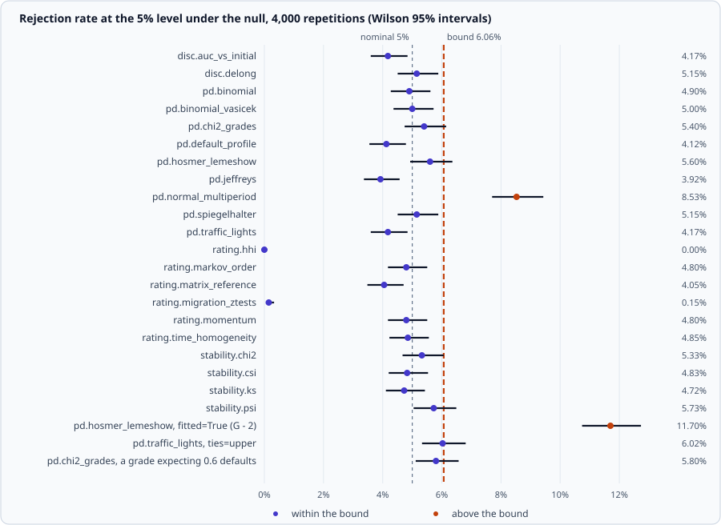

# Known-truth generators and the size and power harness

A validation test is evidence only as far as its size (how often it rejects a right model) and its power (how often
it catches a wrong one) are known. With real outcomes the truth is unknown, so neither can be measured; with a
generator whose parameters are known, both can. `riskvalidation.generators` holds the data-generating mechanisms,
each with its exact truth and a verifier; `riskvalidation.harness` runs a registered test over repetitions of a
generator and reports rejection rates with their Monte Carlo error, exact rejection probabilities where a formula
exists, and estimator performance.

| Page | Contents |
|---|---|
| [01. Size and power](generators/01_size-and-power.md) | the design of a simulation study (ADEMP), the Monte Carlo standard error, the Wilson interval, the size bound, streams and seeds, exact rejection probabilities, estimator performance, the published reproductions |
| [02. Default counts](generators/02_default-counts.md) | BCBS WP14's one-factor model with time correlation; the binomial test under correlation; the normal and traffic-lights study (WP14 Tables 5 to 8) reproduced, and the traffic-lights tie rule |
| [03. Scored samples and portfolios](generators/03_scores-and-portfolios.md) | binormal scores with an exact AUC and AUC variance, a development sample, a challenger, a leaked feature; Demler et al.'s nested discriminants; the logistic portfolio with planted miscalibration |
| [04. Drift and ratings](generators/04_drift-and-ratings.md) | Yurdakul and Naranjo's two-sample design (Table 4 reproduced); migration matrices with a planted non-monotone cell; grade frequencies with planted concentration, and the bounded ECB concentration statistic |
| [05. Rating paths](generators/05_rating-paths.md) | continuous-time rating paths from a known generator, with dos Reis et al.'s self-exciting momentum, regimes and informative withdrawals, observed as CEREP observes ratings; the null and the planted defects of the [transitions](transitions.md) tests |
| [06. Size and power studies](generators/06_size-studies.md) | the named studies of the 21 p-value tests (`size_studies.STUDIES`, `simulate_study`), their generators for the IFRS 9, LGD, PFE, ES, VaR-hit, PIT and Monte Carlo back-tests, and the ML pipelines |

The findings the harness produced in 0.03.000 are recorded on each test's page: the Hosmer-Lemeshow degrees of freedom
(the default changed), the traffic-lights tie rule, the normal test's size over five years, the chi-square test over
thin grades, the ECB AUC test with an estimated development AUC, and the ECB concentration test's bounded statistic.

