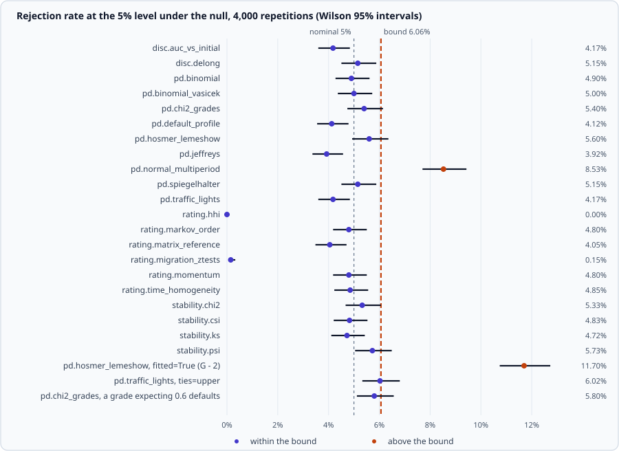
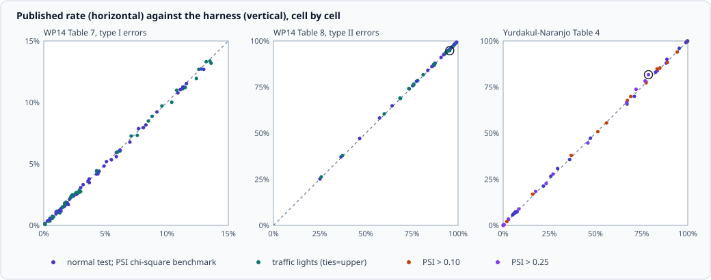

# 01. Size and power

`riskvalidation.harness`

Simulation studies "are computer experiments that involve creating data by pseudo-random sampling from known
probability distributions ... A key strength of simulation studies is the ability to understand the behaviour of
statistical methods because some 'truth' ... is known from the process of generating the data" (Morris, White and
Crowther 2019, *Using simulation studies to evaluate statistical methods*, Statistics in Medicine 38(11), 2074 to
2102, [doi:10.1002/sim.8086](https://doi.org/10.1002/sim.8086)). The harness applies that to the validation tests: the
size of a test is its rejection rate on data where its null hypothesis holds, the power its rejection rate under a
planted defect, and both are estimates that carry Monte Carlo error.



## 1. The design: aims, mechanisms, estimands, methods, performance

Morris et al. structure a study by "aims, data-generating mechanisms, estimands, methods and performance measures
('ADEMP')", the order in which it is reported. Here:

| Element | In the harness |
|---|---|
| Aims | the size of each test at its null boundary; its power against each planted defect; the bias and standard errors of each estimator |
| Data-generating mechanisms | the generators of pages 02 to 04, each a frozen configuration with an exact truth |
| Estimands | the true rejection probability of a test at a level; the true value of a quantity (an AUC, a PD) |
| Methods | the registered tests and estimators, called exactly as a validator calls them |
| Performance measures | rejection rates with their Monte Carlo SE; bias, empirical SE, model SE and coverage |

Their review found that 93 of 100 simulation studies in a volume of Statistics in Medicine did not report Monte Carlo
standard errors. Every rate the harness reports has one.

## 2. The rejection rate and its Monte Carlo error

With $n$ repetitions and $k$ rejections the rate $\hat r = k/n$ estimates the true rejection probability $r$, with the
Monte Carlo standard error of Morris et al.'s Table 6 ("Rejection % (power or type I error)"):

$$\widehat{\mathrm{SE}}(\hat r) = \sqrt{\frac{\hat r\,(1 - \hat r)}{n}}.$$

The interval is Wilson's score interval,

$$\frac{\hat r + \frac{z^2}{2n} \pm z\sqrt{\frac{\hat r(1-\hat r)}{n} + \frac{z^2}{4n^2}}}{1 + \frac{z^2}{n}},$$

which Brown, Cai and DasGupta recommend for small $n$ ("we recommend the Wilson interval or the equal-tailed Jeffreys
prior interval for small n and the interval suggested in Agresti and Coull for larger n", *Interval estimation for a
binomial proportion*, Statistical Science 16(2), 2001, [doi:10.1214/ss/1009213286](https://doi.org/10.1214/ss/1009213286));
it stays inside [0, 1] and behaves near 0, where small sizes such as 0.1% sit.

**How many repetitions.** Inverting the SE gives $n = r(1-r)/\mathrm{SE}^2$; "the worst-case SE occurs when coverage
is 50%. In this scenario, to keep the required Monte Carlo SE below 0.5%, (1) says that nsim = 10,000 repetitions will
achieve this" (Morris et al., section 5.3). The suite uses 4,000 repetitions for sizes (SE 0.34% at a 5% rate),
10,000 and 25,000 to match the published studies it reproduces.

**The size bound.** Under the null at its boundary the true rejection rate is the nominal $\alpha$ for an exact test
with a continuous statistic and at most $\alpha$ for a conservative or discrete one, so a measured size is judged one
sided: a test holds its size when

$$\hat r \le \alpha + z_{0.999}\sqrt{\alpha(1-\alpha)/n}$$

(`size_bound`, `within_size`), 6.06% at $\alpha$ = 5% for 4,000 repetitions. A rate above it is not Monte Carlo noise at
the 0.1% level. Against an exact probability $p$ the check is two-sided, $|\hat r - p| \le 3.29\sqrt{p(1-p)/n}$
(`agrees`); against a published simulated rate $p'$ of $n'$ runs both rates are estimates, and the difference is
judged by $\sqrt{\bar r(1-\bar r)(1/n + 1/n')}$ at the pooled rate (`agrees_with_published`).

**Decision rules.** Rejection at level $\alpha$ is $p < \alpha$, the package's light rule (amber below 5%, red below
1%). Morris et al. write $p \le \alpha$; the two coincide for continuous p-values. Other rules read the result: the
PSI's 0.10 and 0.25 rules of thumb are `metric_above(0.10)` and `metric_above(0.25)`. A result without a p-value is
undefined: never a rejection, and counted.

## 3. Seeds and streams

"Set the seed at the beginning, once and only once" and store the generator's state at each repetition (Morris et al.,
section 4.1). Deriving repetition seeds from consecutive draws of one stream makes the datasets overlap: "Such
dependency in simulated data can compromise both performance estimates and Monte Carlo SEs and must be avoided." The
harness spawns one independent stream per repetition from one seed, `SeedSequence(seed).spawn(n_rep)`, so repetition
$i$ re-runs alone to the same data (tested). A test with its own randomness, the Monte Carlo p-value of
`pd.default_profile`, receives a seed drawn from the repetition's stream after the data, never a constant: the paper
warns to check "that such programs do not manipulate the seed". Results of deterministic tests are cached by their
inputs when every input is short (at most 256 values): equal inputs give equal results, so the cache changes the time,
never the numbers.

## 4. Exact rejection probabilities

`pd.binomial`, `pd.binomial_vasicek` and `pd.jeffreys` see the data only through one default count $D$, and their
p-values fall as $D$ grows. Each rejects at level $\alpha$ exactly when $D \ge k^*$, the smallest count whose p-value is
below $\alpha$ under the PD applied, so under a true PD $\pi$ and asset correlation $\rho$

$$P(\text{reject}) = P_{\pi,\rho}(D \ge k^*) = \int \bar F_{\mathrm{Bin}(n, p(x))}(k^* - 1)\,\varphi(x)\,dx,\qquad
p(x) = \Phi\!\left(\frac{\Phi^{-1}(\pi) - \sqrt\rho\,x}{\sqrt{1-\rho}}\right).$$

`critical_count` finds $k^*$ by bisection on the registered test itself, and `rejection_probability` returns the tail
from the one-factor mixture (256-node Gauss-Hermite; within $10^{-15}$ of an adaptive quadrature for 1,000 obligors).
For the traffic-lights test with independent years, `traffic_lights_rejection_probability` convolves, year by year,
each year's exact colour probabilities (the binomial count coloured by the test's own rule) and sums the profiles in
the test's own rejection region. Both are held to the simulation cell by cell (`tests/test_harness.py`), so an exact
value checks the generator, the harness and the test together, and the web can compute size and power live without
simulating.

## 5. Estimator performance

`estimator_performance(estimates, truth, model_se=..., lower=..., upper=...)` returns the measures of Morris et al.'s
Table 6 with their Monte Carlo SEs: bias $\bar\theta - \theta$ (SE $\sqrt{\sum(\hat\theta_i - \bar\theta)^2/(n(n-1))}$),
empirical SE (SE $\mathrm{EmpSE}/\sqrt{2(n-1)}$), the average model SE and its relative error against the empirical SE,
and the coverage of an interval (SE $\sqrt{c(1-c)/n}$). On the AUC of binormal scores the ECB standard error averages
the exact one and the normal 95% interval covers 93% to 95% ([discrimination](../tests/02_discrimination.md)).

## 6. Published simulations reproduced

| Study | Cells | Reproduced | Not reproduced, with the evidence |
|---|---|---|---|
| BCBS WP14 Tables 7 and 8, normal and traffic-lights tests, 25,000 runs | 144 | 143 | Table 8, DV_LV, traffic lights at 0.1%: printed 0.955, measured 0.9475 (SE 0.0005, 200,000 runs) ([page 02](02_default-counts.md)) |
| Yurdakul and Naranjo (2020) Table 4, PSI rules and benchmark, 10,000 runs | 54 | 53 | m = 100, n = 400, shift 1/2, PSI > 0.25: printed 0.787, measured 0.817 ([page 04](04_drift-and-ratings.md)) |
| Demler, Pencina and D'Agostino (2012), DeLong on nested discriminants, 1,000 runs | 1 | 1 | none: 1 rejection in 1,000 at 5%, their 0.001 ([page 03](03_scores-and-portfolios.md)) |

The traffic-lights cells reproduce only with the tie rule WP14's simulation must have used, which differs from its
printed colour mapping ([page 02](02_default-counts.md)).



## 7. Using the harness

```python
from riskvalidation.generators import DefaultCounts, feed_cell
from riskvalidation.harness import rejection_probability, simulate

gen = DefaultCounts(obligors=1000, pd_true=0.01, rho=0.05)            # the PD is right, defaults correlated
sim = simulate("pd.binomial", gen, n_rep=4000, seed=1, feed=feed_cell())
rate = sim.rate(0.01)                                                  # rate, se, Wilson interval
exact = rejection_probability("pd.binomial", 1000, 0.01, 0.01, rho_true=0.05)["probability"]   # 0.111
```

`simulate` returns the rates per level and rule, the p-values, metrics and statistics of every repetition, the
generator's configuration and truth, and `to_dict()` with a p-value histogram (flat under an exact null). A product's
own wrapper of a registered test (for example the portfolio row of `pd_jeffreys_grades`) is accepted as the test.

## 8. What a measured size does not say

A test that holds its size on a generator holds it for that generator's assumptions, not for every portfolio; each
rate on these pages names its mechanism, its sample sizes and its number of repetitions. Power against a planted
defect is not the probability of detecting a real bank's problem. No size or power figure here is a regulatory
threshold.
