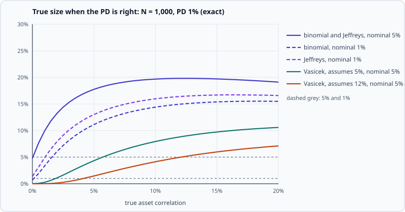
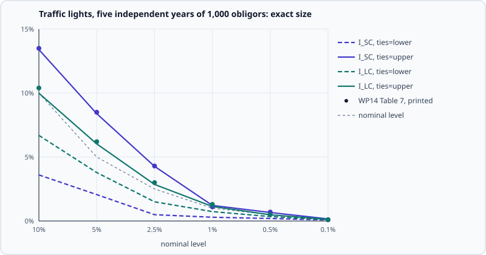

# 02. Default counts in the one-factor model

`riskvalidation.generators.DefaultCounts`

The generator implements the model of the Basel Committee's own simulation study of the calibration tests (BCBS,
*Studies on the Validation of Internal Rating Systems (revised)*, Working Paper 14, May 2005, pages 61 to 67,
[bis.org](https://www.bis.org/publications/studies-validation-internal-rating-systems-revised.pdf)): "an extension of the
Vasicek model which was used in deriving the Basel II risk-weight functions into the time dimension".

## 1. The model

A fixed portfolio is observed in years $t = 1, \dots, T$, with $N_t$ obligors in year $t$ (per grade $g$, $N_{tg}$).
"The change in the general economic conditions from year $t - 1$ to year $t$ is expressed by the random variable
$S_t$. Small values of $S_t$ reflect poor economic conditions." The factors are jointly standard normal with

$$\mathrm{corr}(S_s, S_t) = \vartheta^{|s-t|},$$

and "conditional on S, the numbers of default $D_t$ are independent and binomially distributed with sizes $N_t$ and
conditional default probabilities"

$$p_t(S) = \Phi\!\left(\frac{\Phi^{-1}(p_t) - \sqrt{\rho_t}\,S_t}{\sqrt{1 - \rho_t}}\right),$$

$\rho_t$ the asset correlation of year $t$, $p_t$ the unconditional (true) PD. The PDs a test is given are the
forecasts (`pd_forecast`); when they equal the true PDs every calibration null holds at its boundary, and a forecast
below the truth plants a miscalibration. `draw` consumes its stream as one standard normal per year (multiplied by the
Cholesky factor of the factor correlation when $\vartheta \ne 0$), then the binomial counts, so a panel of independent
years reproduces exactly the generator of Contraste's case C05.

## 2. The truth

Two obligors default together with probability $\pi_2 = \Phi_2(c, c; \rho)$, $c = \Phi^{-1}(p)$, computed as

$$\Phi_2(c, c; \rho) = \Phi(c)^2 + \int_0^\rho \frac{e^{-c^2/(1+r)}}{2\pi\sqrt{1 - r^2}}\,dr$$

(the derivative of the bivariate normal distribution function in its correlation is its density, Plackett's
identity). Hence the variance of a year's count and the default correlation,

$$\mathrm{Var}(D) = N p(1-p) + N(N-1)(\pi_2 - p^2),\qquad \mathrm{corr}(\mathbb 1_i, \mathbb 1_j) = \frac{\pi_2 - p^2}{p(1-p)}.$$

The default correlation reproduces WP14's tabulated column to the printed two decimals in all its examples (0.41%,
0.94%, 1.60% and 2.41% at PD 1% for asset correlations of 5% to 20%; 0.25%, 0.58%, 1.03%, 1.60% at 0.5%; 1.20%,
2.55%, 4.08%, 5.78% at 5%). `verify()` draws 20,000 panels on its own stream and checks every count's mean and
variance and the factor correlation at lag one within four Monte Carlo standard errors.

Feeds turn a panel into a test's arguments: `feed_cell(t, g)` (one grade in one year, for the count tests),
`feed_series(g)` (one grade over the years, for the normal and traffic-lights tests), `feed_grades(t)` and
`feed_portfolio(t)` (the grades of a year, or their total with the obligor-weighted PD, the ECB's portfolio row).

## 3. The binomial test under correlation, exactly

WP14 (page 41): "the true type I error ... can be much larger than the nominal level of the test if default events are
correlated." With the exact rejection probability of [page 01](01_size-and-power.md), for 1,000 obligors at PD 1%:

| True asset correlation | 0% | 5% | 10% | 15% | 20% |
|---|---|---|---|---|---|
| binomial, nominal 1% (reject from 19 defaults, WP14 Example 3) | 0.69% | 11.1% | 14.4% | 15.4% | 15.5% |
| binomial, nominal 5% (from 16) | 4.79% | 17.8% | 19.7% | 19.7% | 19.1% |

The Vasicek-corrected test assuming the true correlation holds its size (4.34% at 5% for 5%); assuming too little it
over-rejects (7.94% when the truth is 10%), and its power is the price (14.5% against 38.8% for a PD understated by a
third, at correlation 5%). WP14 gives a large-portfolio approximation of the true confidence of an independence-based
test of confidence $q$ (page 59, `wp14_true_confidence`):

$$q_{correlated} = \Phi\!\left(\frac{\sqrt{1-\rho}\;\Phi^{-1}\!\big(PD + \Phi^{-1}(q)\sqrt{PD(1-PD)/n}\big) - \Phi^{-1}(PD)}{\sqrt{\rho}}\right),$$

drawn in its Figure 9 for $q$ = 99.9%, PD 0.5% to 9.5%, pools of 100 to 1,900 and "the correlation ρ as set for the
QIS 3", in bands of 70% to 100%; with the Basel corporate correlation (taken as the QIS 3 one, not verified) the
formula stays inside those bands over the figure's grid (tested).

## 4. The normal and traffic-lights study, reproduced

WP14 simulated both multi-period tests on five years of 1,000 obligors, "every scenario ... investigated with 25,000
simulation runs", in eight type I scenarios (Table 5: independence or factor correlation 0.2 with asset correlations
0.05 to 0.09; PDs small or large, constant or varying) and four type II scenarios (Table 6: true PDs 0.05 or 0.5
percentage points above the forecasts). The suite reruns each scenario with 25,000 runs (`test_wp14_tables_7_and_8`,
fixtures in `tests/fixtures/wp14_tables_5_to_8.json`) and compares each of the 144 published rates within 3.29
standard errors of the difference.

- **The normal test**: all 72 cells reproduce. Its type I error is above the nominal level at 0.5% and 0.1% in all
  eight scenarios, at 1% in seven (DV_SV prints exactly 1.0%), and at every level under independence, as Table 7
  prints, although WP14's summary calls its bias "conservative".
- **The traffic-lights test**: 71 of 72 cells reproduce, with `ties="upper"`. The cell that does not is Table 8,
  DV_LV, at 0.1%: printed 0.955; measured 0.9467 at 25,000 runs and 0.9475 (SE 0.0005) at 200,000. The neighbouring
  levels agree (printed 0.935 and 0.936, measured 0.937 and 0.938); a misprint of 0.945 would fit (unverified).

**The tie rule.** WP14 prints the colour mapping "g, $x \le \Phi^{-1}(q_g)$" (a year on a boundary takes the better
colour). In every WP14 scenario $N_t p_t$ is a whole number of defaults, and a year with exactly that many sits on the
green boundary, with probability between 5% and 37%. Under the printed rule its scenarios' sizes are far below the
published ones (I_SC at 10%: 3.6% exact against 13.5% printed); giving the boundary year the worse colour reproduces
the published rates in the independence scenarios to within WP14's own Monte Carlo error (13.4% exact) and within
the combined error everywhere else. The
package keeps the printed rule as the default and offers `ties="upper"`; [PD calibration](../tests/01_pd-calibration.md)
shows the sizes under both.

## 5. Caveats

- One factor drives every obligor of a year; sector concentration, heterogeneous correlations and contagion are
  outside the model.
- The factor correlation is the only time dependence; a regime switch or a trend in PDs needs a different mechanism.
- Counts are binomial given the factor: obligors within a grade share one PD.
