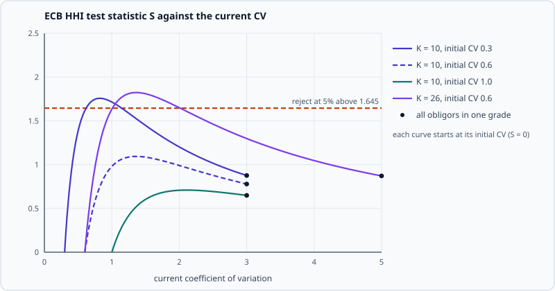

# 04. Drift and ratings

`riskvalidation.generators.TwoSample`, `Migrations`, `GradeFrequencies`

## 1. Two samples of one variable (Yurdakul and Naranjo's design)

Yurdakul and Naranjo, *Statistical properties of the population stability index*, Journal of Risk Model Validation
14(4), 89 to 100 (2020), [doi:10.21314/JRMV.2020.227](https://doi.org/10.21314/JRMV.2020.227), section 4: "We generated
n observations from the $N(\mu_1 = 0, \sigma^2 = 64)$ and let $(\hat p_1, \ldots, \hat p_{10})$ be the observed proportions
that fall into the B = 10 population deciles. A second sample of m observations was generated from $N(\mu_2, \sigma^2 =
64)$ and we let $(\hat q_1, \ldots, \hat q_{10})$ be the observed proportions falling into the deciles of
$N(0, \sigma^2 = 64)$. We used three values, $\mu_2$ = 0, 2, 4, representing mean shifts of 0, 1/4 and 1/2 standard
deviations."

`TwoSample(n_base, n_target, shift, scale, sd=8, bins=10, binning="population")` draws the base and the target and bins
them at the base population's deciles; `binning="sample"` uses the base sample's own deciles instead, as
`quantile_edges` does in practice. The truth holds the exact bin probabilities of both populations,

$$p_i = \Phi(e_i/\sigma) - \Phi(e_{i-1}/\sigma),\qquad q_i = \Phi\!\left(\frac{e_i - \mu_2}{s\,\sigma}\right) - \Phi\!\left(\frac{e_{i-1} - \mu_2}{s\,\sigma}\right),$$

the population PSI $\sum (q_i - p_i)\ln(q_i/p_i)$, and for a pure shift the Wasserstein-1 distance $|\mu_2|$.

**Table 4, reproduced.** 53 of the 54 cells agree within 3.29 combined standard errors (`test_yurdakul_naranjo_table4`,
fixture `tests/fixtures/yurdakul_naranjo_table4.json`). The cell that does not: $m = 100$ (target), $n = 400$ (base),
shift 1/2, PSI > 0.25: printed 0.787, measured 0.817 at 10,000 runs and 0.8175 at 20,000. The paper does not say how
an empty bin is treated; the shifted target leaves its lowest decile empty in 2.8% of the samples, but no treatment
explains the gap (floor at half an observation 0.8175, drop the empty bins 0.8075, add one half to every bin 0.7406,
which breaks the other rows). The finding that matters reproduces everywhere: PSI > 0.10 rejects 85% of the time
when nothing changed and samples are 100, and PSI > 0.25 loses power as samples grow.

**Binning.** The chi-square benchmark assumes bins fixed in advance. Measured with 4,000 repetitions on equal samples,
the base sample's own deciles give the same size within Monte Carlo error (7.45% against 7.67% at 100, 5.03% against
5.47% at 400, 4.98% against 4.67% at 2,000; [stability](../tests/04_stability.md)).

## 2. Migration matrices

`decaying_matrix(k, stay=0.8, decay=0.5)` builds a $k \times k$ matrix with `stay` on the diagonal and off-diagonal
cells falling by `decay` per notch on both sides, so every cell is below its neighbour closer to the diagonal: strictly
inside the null of the ECB's migration z-tests (2019, section 2.5.5.2). `break_monotonicity(m, row, col, ratio)` sets a
cell two or more notches from the diagonal to `ratio` times its closer neighbour, the mass coming from the diagonal
cell: `ratio=1` is the null's boundary, above 1 the defect. `Migrations(obligors, matrix)` draws one multinomial row per
starting grade; its truth holds the expected counts and how many cells are inside, on the boundary of and outside the
null.

Measured ([rating system](../tests/03_rating-system.md)): at the boundary the family-wise p-value of the package rejects
0.15% of the time at 5% (Holm over 42 cells); a cell twice its closer neighbour is caught half the time with 500
obligors per grade and always with 2,000.

## 3. Grade frequencies and concentration

`GradeFrequencies(obligors, probabilities, initial, development_obligors=None)` draws the current grade counts,
multinomial, and hands the ECB test the development distribution as fixed; with `development_obligors` it also draws a
development sample from `initial`, so a two-sample test of the counts runs on the same data; `concentrate(p, share)` moves `share` of every grade's mass into the modal grade,
$(1 - s)\,p + s\,e_{mode}$, which raises the Herfindahl index. The truth holds the CV and HI of both distributions.

The ECB's concentration test cannot reject in common settings: its statistic
$S(c) = \sqrt{K-1}\,(c - CV_{init})/(c\sqrt{0.5 + c^2})$ is bounded in the current CV $c$, and with ten grades and an
initial CV of 0.6 its maximum, 1.094, is below the 5% critical value. Moving half of every grade's mass into the modal
grade (HI from 0.13 to 0.58) was rejected in none of 2,000 repetitions. The chi-square test of homogeneity on the
counts sees it: with 5,000 obligors in each sample (1,000 repetitions) it rejects 6.1% of the time with no change and
9.2%, 23.6%, 94.5% and 100% when 1%, 2%, 5% and 10% of the mass moves into the modal grade.

## 4. Caveats

- Normal variables with a mean shift are the simplest drift; real drift changes shape, and the PSI's power depends on
  where in the distribution it happens.
- The migration generator has independent obligors within a row; rating migrations in a downturn are correlated, which
  widens every interval the z-tests assume.
- The ECB concentration formula is the one transcribed from the 2019 instructions (section 2.5.5.3); the source it cites
  for the variance (Miller 1991) was not read.
