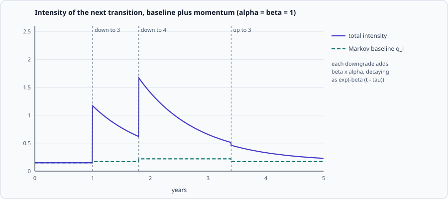

# 05. Rating paths

`riskvalidation.generators.paths.RatingPaths`

Every estimator and test of the [transitions](../transitions.md) section is judged against this generator, because it
is the only place where the true generator, the true PD by grade and the true defect are known. It draws obligors'
rating paths in continuous time, observes them as CEREP observes ratings (snapshots at dates), and can plant the three
defects a validator must be able to detect, or be fooled by.

## 1. The Markov case

A continuous-time chain with generator $Q$: an obligor in state $i$ waits an exponential time of rate
$q_i = -q_{ii}$ and jumps to $j$ with probability $q_{ij}/q_i$; default, the last state, is absorbing. Simulation is
exact (competing exponential clocks), vectorised over the obligors.

```python
from riskvalidation.generators.paths import RatingPaths

gen = RatingPaths(Q, obligors=(1000,) * 5, horizon=5.0, snapshots=(0.0, 1.0, 2.0, 3.0, 4.0, 5.0))
d = gen.draw(np.random.default_rng(1))
d["segments"]   # obligor, start, stop, state, to: every stay of every obligor
d["steps"]      # one {"counts": m x m, "withdrawn": m} per step between snapshots, CEREP's layout
d["triplets"]   # n_ijk over consecutive triples of snapshots, for the order test
gen.truth()     # Q, exp(Q), the PD by grade at 1 to 5 years, the step matrices, the regimes and flags
```

## 2. Momentum

dos Reis, Pfeuffer and Smith (2020, Quantitative Finance; arXiv 1809.09889v2), section 4.2: "start with a CTMC (with
generator matrix Q), which acts as a baseline intensity, then add a non-Markov component which is a self-excitation
intensity decaying exponentially. That is, any downgrade observed increases the intensity of [the] future downgrades
for a certain while." With state $h$ (default) absorbing,

$$\lambda_g(t) = \sum_{j=1}^{h-1} q_j 1\{X(t) = j\} + \sum_{m=1}^{2} \sum_{\tau \in \tau_m(t)} \beta_m \alpha_m
e^{-\beta_m (t - \tau)},$$

"where $m$ denotes investment or speculative downgrade, $\tau_m(t)$ is the set of downgrade times (of type $m$) prior
to time $t$ and $\alpha_m$ and $\beta_m$ correspond to the intensity and memory of the 'momentum' in each case". Their
assumptions, kept here: downward momentum only; two types, by whether the downgrade left an investment grade
(`investment_grades` sets how many grades are investment grade); and "no points occurred prior to time 0, the
so-called edge effects. This essentially means that companies do not have momentum when they are initially rated." The
marks: a baseline jump goes to $k$ with weight $q_{jk}$; the excitation goes to the $N_j$ downgrade destinations with
$q_{jk} > 0$ in equal parts.



`momentum=((alpha_1, beta_1), (alpha_2, beta_2))`. The chain is then not Markov: the hazard of leaving a grade depends
on how the obligor entered it, which the order and momentum tests detect ([page 03](../transitions/03_markov-tests.md),
section 6). The intensity is simulated exactly by Ogata's thinning: for each obligor, the baseline's largest exit rate
over the regimes plus its current excitation bounds its intensity until its next event, because the excitation only
decays between events.

## 3. Regimes

`regimes=((start, Q_r), ...)` switches the generator at calendar times (a recession regime from the third year, say).
The chain stays Markov but is not time-homogeneous; the truth says so (`time_homogeneous`), and the step matrices are
then not given as one $\exp(\Delta Q)$.

## 4. Withdrawals

`withdrawal_rate=w` adds an exit at rate $w$ from every non-default state, and `informative=k` raises it to
$w(1 + k)$ within the last `window` years before the obligor's default, so the ratings about to default are withdrawn
more often. Withdrawals are drawn after the path from that piecewise exponential hazard and truncate it (the stay ends
with `to = WITHDRAWN`). This is the bias the industry treatment of withdrawals cannot see (Schuermann and Hanson's
"non-informative" assumption, against EBA/GL/2017/16 paragraph 76; [page 01](../transitions/01_estimators.md)).

## 5. Snapshots: CEREP's stock model

`snapshots=(t_0, ..., t_K)` gives each obligor's state at each date, a rating withdrawn by a date counted in its start
state's withdrawals, as ESMA's help file defines its transition page: "If the rating is withdrawn at the end of the
statistics period, it is included in the 'Withdrawals' column according to the Category or Notch it was rated with at
the start of the statistics period." Each step between dates gives a count matrix and a withdrawals vector in CEREP's
layout, and consecutive triples give $n_{ijk}$.

## 6. Truth and verifier

`truth()` holds the baseline generator, the regimes, whether the chain is Markov and time-homogeneous, $\exp(Q)$, the
PD by grade at 1 to 5 years, the exact step matrices (homogeneous Markov case), and the withdrawal parameters.
`verify()` checks, in the homogeneous Markov case without withdrawals, that the jumps per unit of time reproduce
$q_{ij}$: $K_{ij}/S_i$ against $q_{ij}$ with the Poisson standard error $\sqrt{K_{ij}}/S_i$, for every move with at
least 200 expected jumps (`tests/test_generators.py::test_rating_paths`, RV-412).

## 7. Where it is used

- The size study's Markov chain (`tests/test_size.py`): five grades and default, 1,000 obligors per grade, five annual
  snapshots, the null of all four transition tests.
- The power of those tests against momentum and a recession regime ([page 03](../transitions/03_markov-tests.md)).
- The estimators against the truth: cohort zeros against duration, the EM generator, the intervals' coverage and the
  bootstrap ([pages 01, 02 and 04](../transitions.md)).
- The parametric bootstrap of `pd_bootstrap`, which simulates synthetic histories from an estimated generator.
