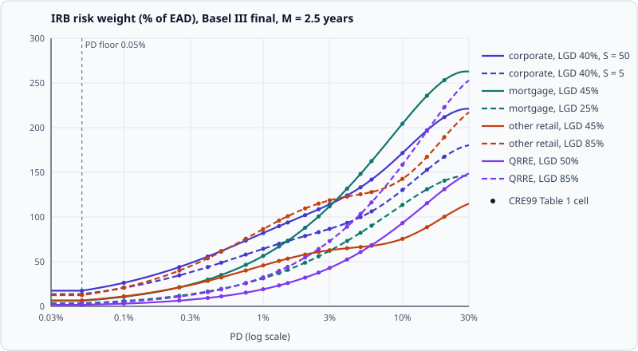

# 01. IRB risk-weight functions

`riskvalidation.regulatory.irb`

Banks with supervisory approval compute credit-risk capital from their own estimates of PD (and, in the advanced
approach, LGD and EAD) through the internal ratings-based (IRB) risk-weight functions. The functions turn one
exposure's parameters into a capital requirement $K$ per unit of exposure; a validator recomputes them to check a
bank's capital, to see what a change in a model's PDs does to capital, and to compare frameworks. This page states the
functions as published, the parameters each regime fixes, and how the module reproduces the Basel Committee's own
illustrative table.

## 1. The functions (Basel III final, CRE31)

Sources: the consolidated Basel Framework, chapters CRE31 (risk-weight functions) and CRE32 (risk components), both in
force from 2023-01-01, published 2020-03-27
([CRE31](https://www.bis.org/committees/bcbs/basel-framework/standard/cre/31/inforce/2023-01-01/published/2020-03-27),
[CRE32](https://www.bis.org/committees/bcbs/basel-framework/standard/cre/32/inforce/2023-01-01/published/2020-03-27)).
PD and LGD are decimals, $N$ is the standard normal distribution function and $G = N^{-1}$ (CRE31.2), $M$ is the
effective maturity in years.

**Corporate, sovereign and bank exposures** (CRE31.5):

$$R = 0.12\,\frac{1 - e^{-50\,\mathrm{PD}}}{1 - e^{-50}} + 0.24\left[1 - \frac{1 - e^{-50\,\mathrm{PD}}}{1 - e^{-50}}\right], \qquad b = \big(0.11852 - 0.05478\,\ln \mathrm{PD}\big)^2,$$

$$K = \left[\mathrm{LGD}\cdot N\!\left(\frac{G(\mathrm{PD})}{\sqrt{1 - R}} + \sqrt{\frac{R}{1 - R}}\,G(0.999)\right) - \mathrm{PD}\cdot\mathrm{LGD}\right]\frac{1 + (M - 2.5)\,b}{1 - 1.5\,b}, \qquad \mathrm{RWA} = 12.5\cdot K\cdot\mathrm{EAD}.$$

- Large or unregulated financial institutions (CRE31.7): $R$ times 1.25, for regulated financial institutions with
  total assets of at least USD 100 billion and for unregulated financial institutions of any size.
- Firm-size adjustment (CRE31.8): for corporates with consolidated annual sales $S$ below EUR 50 million,
  $R$ less $0.04\,(1 - (S - 5)/45)$, with $S$ floored at 5.
- High-volatility commercial real estate (CRE31.11): the upper correlation 0.30 instead of 0.24.
- Defaulted exposures (CRE31.3): $K = \max(0, \mathrm{LGD} - \mathrm{EL}_{BE})$, with $\mathrm{EL}_{BE}$ the bank's best
  estimate of expected loss.

**Retail exposures** (CRE31.13 to CRE31.16) use the same $K$ without the maturity adjustment, with

| Sub-class | Correlation $R$ | Paragraph |
|---|---|---|
| Residential mortgage | 0.15 | CRE31.14 |
| Qualifying revolving retail (QRRE) | 0.04 | CRE31.15 |
| Other retail | $0.03\,\frac{1 - e^{-35\,\mathrm{PD}}}{1 - e^{-35}} + 0.16\left[1 - \frac{1 - e^{-35\,\mathrm{PD}}}{1 - e^{-35}}\right]$ | CRE31.16 |

The first term of $K$ is LGD times the 99.9% quantile of the default fraction of the one-factor model's large
homogeneous portfolio (see the [Vasicek page](../engines/01_vasicek-lhp.md)); the second removes the expected loss,
which provisions are meant to cover (section 4).

## 2. What each regime fixes

A regime is data: a record of the parameters a framework sets, each with its paragraph and the in-force date of its
chapter (`REGIMES`, each serialisable with `Regime.to_dict()`).

| Regime id | Framework | 1.06 scaling | PD floor | Notes |
|---|---|---|---|---|
| `basel3` | Basel III final, CRE31 and CRE32, in force 2023-01-01 | none | 0.05% (CRE32.4); retail 0.05%, QRRE revolvers 0.10% (CRE32.58); sovereigns exempt | the reference |
| `crr3` | EU CRR3, Regulation (EU) 2024/1623, Article 153; applies from 2025-01-01 | none | 0.05%; QRRE revolvers 0.10% | the Basel III formula; [EUR-Lex](https://eur-lex.europa.eu/legal-content/EN/TXT/HTML/?uri=CELEX:32024R1623) |
| `basel2` | Basel II, CRE30.4 and CRE32 versions in force 2019-12-15 | 1.06 on IRB RWA (CRE30.4) | 0.03% (corporate, bank and retail) | for comparison with older figures |
| `cl_ran21_6` | CMF Chile, RAN 21-6 numeral 4 (internal methodologies), last amended by Circular N°2.370 of 2026-04-10 | none | 0.05% ("no podrá ser inferior a 0,05%") | own correlations; consumer LGD fixed at 61.3% |

The scaling factor: Basel II required "a scaling factor of 1.06" on IRB RWA (CRE30.4, version in force 2019-12-15,
[bis.org](https://www.bis.org/committees/bcbs/basel-framework/standard/cre/30/inforce/2019-12-15/published/2019-12-15));
the paragraph is absent from the Basel III final text, whose RWA is $12.5\,K\,\mathrm{EAD}$ only, and from CRR3 Article
153(1). Basel II IRB figures without the 1.06, or Basel III and CRR3 figures with it, are both wrong, and the test
`test_regimes` checks that `basel2` is exactly 1.06 times `basel3` on every CRE99 cell and `crr3` exactly equal to it.

**Chile, RAN 21-6.** The CMF's internal methodologies chapter
([cmfchile.cl](https://www.cmfchile.cl/portal/principal/623/articles-38826_doc_pdf.pdf)) uses the same risk function
(numeral 4.4.1) with its own correlations (numeral 4.4.2), with $w(\mathrm{PD}) = (1 - e^{-50\,\mathrm{PD}})/(1 - e^{-50})$:
corporates $0.12\,w + 0.24\,(1 - w)$; non-bank financial institutions 1.25 times that; SMEs ("PYMES")
$0.08\,w + 0.20\,(1 - w)$, a separate curve rather than Basel's firm-size adjustment; high-volatility commercial real
estate $0.12\,w + 0.30\,(1 - w)$; retail $0.03\,w_{35} + 0.16\,(1 - w_{35})$; residential mortgages 15%. For the consumer
portfolio "se debe considerar una PDI de 61,3%": the regime fixes that LGD, and `capital_requirement` refuses a
different one rather than replacing it silently. The chapter also floors the result at 72.5% of the standardised RWA
(numeral 7, the output floor, not computed here). No Chilean bank uses internal methodologies for capital: "no existen
instituciones bancarias que las utilicen, pues ninguna de éstas lo ha solicitado a la Comisión" (CMF, informe
normativo of August 2026,
[cmfchile.cl](https://www.cmfchile.cl/institucional/legislacion_normativa/normativa_tramite_ver_archivo.php?id=2026080375&seq=1)).

## 3. The adjustments the function applies

`capital_requirement(asset_class, pd, lgd, *, maturity=2.5, sales_eur_m=None, large_fi=False, ead=None,
revolver=False, defaulted=False, el_best_estimate=None, regime="basel3")` returns an `IRBResult` with $K$, the risk
weight $12.5\,K$ times the regime's scaling, the RWA when an EAD is given, and every parameter it used:

- the PD floored at the regime's floor (sovereigns exempt under `basel3` and `crr3`), with the QRRE revolver floor for
  `revolver=True` and the retail floor for a transactor; a PD of 0, the long-run average of a grade with no default in
  any cohort, takes the floor (CRE32.4: "the greater of the one-year PD associated with the internal borrower grade ...
  or 0.05%"), and is refused for an exempt class, where the formula has no value at 0;
- the correlation of the asset class, with the firm-size adjustment and the 1.25 multiplier where they apply;
- the maturity clamped to 1 to 5 years for non-retail classes (CRE32.46 to CRE32.47), and none for retail;
- for a defaulted exposure, $K = \max(0, \mathrm{LGD} - \mathrm{EL}_{BE})$;
- the paragraph reference of each parameter, and a note for each floor or clamp applied.

## 4. Expected loss against provisions

The IRB capital covers unexpected loss; the expected loss $\mathrm{EL} = \mathrm{PD}\times\mathrm{LGD}\times\mathrm{EAD}$
(for defaulted exposures the best estimate) is compared with the eligible provisions (CRE35.2 to CRE35.4). A shortfall
is deducted from CET1 in full (CAP30.13); an excess may count in Tier 2 up to 0.6% of IRB credit RWA (CAP10.19):

$$\text{CET1 deduction} = \max(0,\ \mathrm{EL} - P), \qquad \text{Tier 2 add-back} = \min\big(\max(0,\ P - \mathrm{EL}),\ 0.006\cdot\mathrm{RWA}_{\text{IRB credit}}\big).$$

`el_versus_provisions(expected_loss, eligible_provisions, irb_credit_rwa)`.

## 5. Reproduction of CRE99 Table 1

CRE99 publishes illustrative risk weights for eight exposure types at 18 PDs from 0.05% to 20%
([CRE99](https://www.bis.org/committees/bcbs/basel-framework/standard/cre/99/inforce/2023-01-01/published/2020-03-27)):
corporates with LGD 40% at sales of EUR 50 and 5 million, mortgages with LGD 45% and 25%, other retail with LGD 45% and
85%, QRRE with LGD 50% and 85%, at $M = 2.5$. The table is a fixture of the package
(`tests/fixtures/cre99_table1.json`), and `test_cre99_table1` recomputes all 144 cells: 141 reproduce to the printed
two decimals and three differ by one unit in the last place (other retail LGD 85% at PD 0.10%: 21.0855; other retail
LGD 45% at 1.30%: 50.7945; mortgage LGD 45% at 1.50%: 73.4441). No exact implementation reproduces those three, so the
gate is one unit of the printed precision, 0.01 percentage points, for every cell. The QRRE columns are computed at the
0.05% floor of a transactor, which is what CRE99 tabulates; a revolver at 0.05% would be floored to 0.10%.

## 6. What not to claim

- A recomputation is not a compliance verdict and not an approval: the function reproduces the published formula.
- The 99.9% confidence level cannot be backtested directly: a year in a thousand is never observed.
- Averages of Pillar 3 disclosures are not exact inputs to the non-linear function; recomputing a bank's capital from
  them is a consistency check only.
- Nothing here says that any Chilean bank uses the internal methodologies for capital; none does.

## References

- BCBS, *The Basel Framework*: CRE30, CRE31, CRE32, CRE35, CRE99, CAP10, CAP30, as linked above (bis.org).
- Regulation (EU) 2024/1623 (CRR3), Article 153.
  [EUR-Lex CELEX 32024R1623](https://eur-lex.europa.eu/legal-content/EN/TXT/HTML/?uri=CELEX:32024R1623).
- CMF Chile, Recopilación Actualizada de Normas, chapter 21-6.
  [cmfchile.cl](https://www.cmfchile.cl/portal/principal/623/articles-38826_doc_pdf.pdf).
- BCBS (2005). An explanatory note on the Basel II IRB risk weight functions.
  [bis.org](https://www.bis.org/publications/explanatory-note-basel-ii-irb-risk-weight-functions.pdf).
- Gordy, M.B. (2003). A risk-factor model foundation for ratings-based bank capital rules. *Journal of Financial
  Intermediation* 12(3):199-232. [doi:10.1016/S1042-9573(03)00040-8](https://doi.org/10.1016/S1042-9573(03)00040-8).
