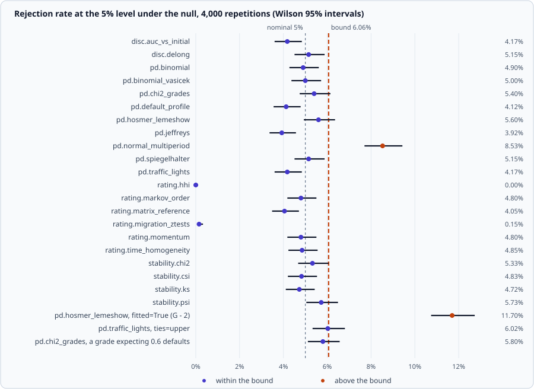

# Validation tests

Each test is a function that returns a `TestResult`. The table lists what exists, the quantity the policy reads,
and the page that gives the formula, the null hypothesis, the decision rule and the primary source.

Conventions used throughout: $\Phi$ is the standard normal CDF; "one-sided" tests are oriented so that rejection
signals the risk-relevant failure (underestimated PD, lost discrimination, lost stability); a rejected test is
evidence for a finding, never an automatic verdict. In the words of the 2011 US supervisory guidance, outcomes
analysis "should involve a range of tests because any individual test will have weaknesses".

| Test id | Name | Decision | Page |
|---|---|---|---|
| `pd.jeffreys` | Jeffreys test (per grade and portfolio) | p-value | [PD calibration](tests/01_pd-calibration.md) |
| `pd.binomial` | Binomial test | p-value | [PD calibration](tests/01_pd-calibration.md) |
| `pd.binomial_vasicek` | Vasicek-corrected binomial test | p-value | [PD calibration](tests/01_pd-calibration.md) |
| `pd.chi2_grades` | Chi-square over grades | p-value | [PD calibration](tests/01_pd-calibration.md) |
| `pd.default_profile` | Chi-square test of the default profile (Monte Carlo) | p-value | [PD calibration](tests/01_pd-calibration.md) |
| `pd.hosmer_lemeshow` | Hosmer-Lemeshow | p-value | [PD calibration](tests/01_pd-calibration.md) |
| `pd.spiegelhalter` | Spiegelhalter | p-value | [PD calibration](tests/01_pd-calibration.md) |
| `pd.normal_multiperiod` | Normal test over several years | p-value | [PD calibration](tests/01_pd-calibration.md) |
| `pd.traffic_lights` | Traffic lights (Blochwitz, Hohl, Wehn) | p-value | [PD calibration](tests/01_pd-calibration.md) |
| `pd.brier` | Brier score with Murphy decomposition | descriptive | [PD calibration](tests/01_pd-calibration.md) |
| `pd.ece` | Expected calibration error | descriptive | [PD calibration](tests/01_pd-calibration.md) |
| `disc.auc` | AUC with ECB standard error, Gini | descriptive | [Discrimination](tests/02_discrimination.md) |
| `disc.auc_vs_initial` | AUC against the development AUC (ECB) | p-value | [Discrimination](tests/02_discrimination.md) |
| `disc.delong` | DeLong test of two correlated AUCs | p-value | [Discrimination](tests/02_discrimination.md) |
| `disc.ks` | Kolmogorov-Smirnov separation | descriptive | [Discrimination](tests/02_discrimination.md) |
| `rating.mwb` | Matrix weighted bandwidth (ECB) | descriptive | [Rating system](tests/03_rating-system.md) |
| `rating.migration_ztests` | Migration matrix z-tests (ECB) | p-value | [Rating system](tests/03_rating-system.md) |
| `rating.hhi` | Concentration in grades (ECB) | p-value | [Rating system](tests/03_rating-system.md) |
| `stability.psi` | Population stability index with chi-square benchmark | p-value | [Stability](tests/04_stability.md) |
| `stability.csi` | Characteristic stability index | p-value | [Stability](tests/04_stability.md) |
| `stability.chi2` | Chi-square test of homogeneity | p-value | [Stability](tests/04_stability.md) |
| `stability.ks` | Two-sample Kolmogorov-Smirnov | p-value | [Stability](tests/04_stability.md) |
| `stability.wasserstein` | Wasserstein-1 distance | descriptive | [Stability](tests/04_stability.md) |

"Descriptive" measures have no thresholds in the default policy: they are shown with their value and no colour
unless an institution's policy sets bands for them.

Every test with a p-value has a measured size: its rejection rate on a known-truth generator where its null holds at
the boundary, with the Monte Carlo error ([generators and the size and power harness](generators.md)). Each family's
page states the measurements, the published simulations they reproduce and where a test departs from its nominal
level.

