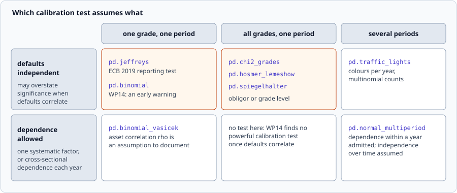
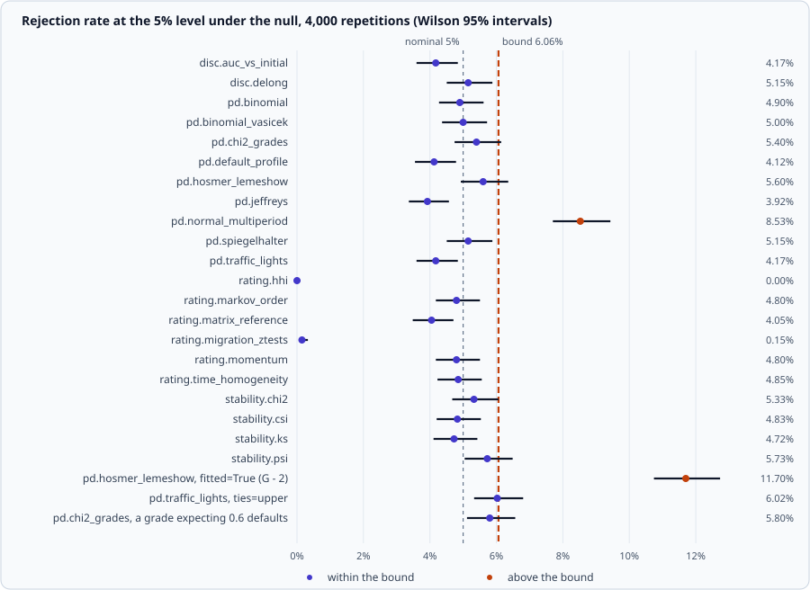
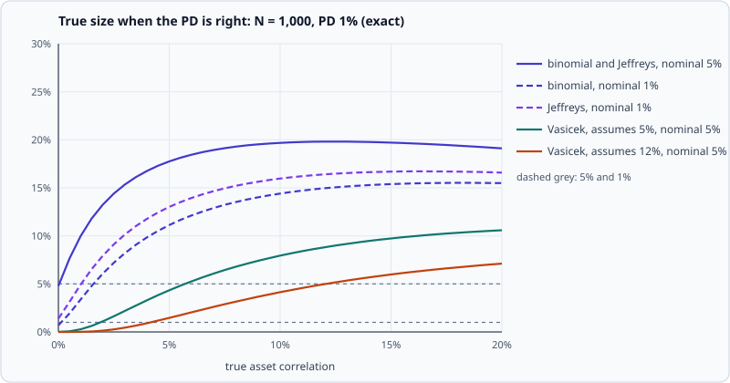

# 01. PD calibration

Calibration asks whether the default rates that occurred are consistent with the PDs the model assigned. The
honest starting point is BCBS Working Paper 14 (2005): "at present no really powerful tests of adequate
calibration are currently available. Due to the correlation effects that have to be respected there even seems
to be no way to develop such tests" ([BIS](https://www.bis.org/publ/bcbs_wp14.htm)). The tests below therefore
differ in what they assume, and a validator reads them together.

Notation: a grade (or portfolio) has $N$ obligors at the start of a one-year period, $D$ defaults during it, and
PD applied $\mathrm{PD}$; across grades $i$ these are $n_i$, $d_i$, $p_i$.

**Size and power, measured.** Since version 0.03.000 every test below has a measured size: its rejection rate on a
known-truth generator where its null holds at the boundary, with the Monte Carlo standard error $\sqrt{r(1-r)/n}$ and a
Wilson interval ([size and power](../generators/01_size-and-power.md)). The count tests (binomial, Vasicek-corrected
binomial, Jeffreys) have exact rejection probabilities, so their size and power need no simulation. The figures quoted
in each section come from the suite (`tests/test_size.py`, 4,000 repetitions unless stated) and from the published
simulations it reproduces.

## Jeffreys test (`pd.jeffreys`)

The test the ECB prescribes for reporting IRB PD back-testing, per grade and for the portfolio ($K+1$ tests)
(ECB, *Instructions for reporting the validation results of internal models: IRB Pillar I models for credit
risk*, February 2019, section 2.5.3.1). With the Jeffreys prior $\mathrm{Beta}(1/2, 1/2)$ the posterior of the
default probability is $\mathrm{Beta}(D + 1/2,\, N - D + 1/2)$ and

$$p = F_{\mathrm{Beta}(D+\frac12,\,N-D+\frac12)}(\mathrm{PD}),$$

the posterior probability that the true PD is below the PD applied.

- $H_0$: the PD applied at the start of the period is greater than or equal to the true PD.
- Reject (PD underestimated) when $p < \alpha$.
- Source of the interval logic: Brown, Cai and DasGupta (2001), *Interval estimation for a binomial proportion*,
  Statistical Science 16(2), 101 to 117, [doi:10.1214/ss/1009213286](https://doi.org/10.1214/ss/1009213286).
- Implementation choice: the portfolio PD is the obligor-weighted average of the grade PDs (the average PD across
  customers). The result also reports the posterior 2.5% and 97.5% quantiles.
- Size, exact: the test is Bayesian, and as a frequentist test on a discrete count its size depends on $N$. With $N =
  1{,}000$ and PD 1% it rejects from 16 defaults at 5% (size 4.79%) and from 18 at 1% (size 1.38%, above the nominal
  level). Correlated defaults inflate it as they inflate the binomial test's: 17.8% at the 5% level when the asset
  correlation is 5%.

## Binomial test (`pd.binomial`)

Under independence $D \sim \mathrm{Bin}(N, \mathrm{PD})$ and the one-sided p-value is
$p = P(\mathrm{Bin}(N,\mathrm{PD}) \ge D)$. WP14 warns that the true type I error "can be much larger than the
nominal level of the test if default events are correlated" and suggests reading the test as "kind of an early
warning system".

The warning, quantified exactly (`riskvalidation.harness.rejection_probability`, the one-factor tail of the next
section): WP14's Example 3 test (PD 1%, $N = 1{,}000$, reject from 19 defaults, nominal level 1%) has a true size of
0.69% under independence and 11.1%, 14.4%, 15.4% and 15.5% when the asset correlation is 5%, 10%, 15% and 20%. WP14's
large-portfolio approximation of the same effect (page 59, `wp14_true_confidence`) is drawn in its Figure 9.

## Vasicek-corrected binomial test (`pd.binomial_vasicek`)

WP14's appendix corrects for correlation with the one-factor model: asset value
$R_i = \sqrt{1-\rho}\,\varepsilon_i + \sqrt{\rho}\,X$ with independent standard normals $X$, $\varepsilon_i$,
default when $R_i \le \Phi^{-1}(\mathrm{PD})$. Conditional on $X = x$ defaults are independent with PD

$$\mathrm{PD}(x) = \Phi\!\left(\frac{\Phi^{-1}(\mathrm{PD}) - \sqrt{\rho}\,x}{\sqrt{1-\rho}}\right),$$

so the default count is a binomial mixture:

$$P(D \ge k) = \int_{-\infty}^{\infty} P\big(\mathrm{Bin}(N, \mathrm{PD}(x)) \ge k\big)\,\varphi(x)\,dx .$$

The package evaluates the integral by Gauss-Hermite quadrature with 256 nodes. For large $N$ the critical
default rate at confidence $q$ is approximately
$\Phi\big((\Phi^{-1}(\mathrm{PD}) + \sqrt{\rho}\,\Phi^{-1}(q))/\sqrt{1-\rho}\big)$, reported as
`large_n_critical_count`.

**Critical counts, and a reconciliation.** WP14 tabulates, for PD 1%, $N = 1{,}000$ and $q = 99\%$, critical
counts of 19, 35, 49, 63 and 77 for $\rho$ = 0%, 5%, 10%, 15% and 20%. These are reproduced exactly by
$k^* = \min\{k : P(D \ge k) \le 1 - q\}$, with rejection when $D \ge k^*$; the 99% quantile of $D$ itself is one
lower (18, 34, 48, 62, 76). The package uses the definition that reproduces the published table (test
`test_wp14_critical_values`). The asset correlation is a modelling assumption that must be documented; the IRB
supervisory correlations are one option.

The correction holds the size at the correlation it assumes (exact: 4.34% at the 5% level for PD 1%, $N = 1{,}000$,
assumed and true correlation 5%) and over-rejects when the true correlation is larger (7.94% when it is 10%). It pays in
power: with the true PD 1.5 times the PD applied and correlation 5%, it rejects 14.5% of the time against the
independence-based test's 38.8%.

## Chi-square test over grades (`pd.chi2_grades`)

$$T = \sum_{i}\frac{(n_i p_i - d_i)^2}{n_i p_i (1 - p_i)},$$

asymptotically $\chi^2$ with as many degrees of freedom as grades under $H_0$ (every grade PD is the true one,
defaults independent within and between grades). WP14: likely to understate the true type I error under default
dependence, and slow to converge for small PDs.

Measured size: 5.40% at the 5% level and 1.47% at 1% for seven grades expecting 5 to 32 defaults each (within Monte
Carlo error). With a thin best grade expecting 0.6 defaults the test exceeds its level: 5.80% at 5% and 1.52% at 1%,
above the bound of 1.49% for 4,000 repetitions (`test_chi2_grades_over_rejects_with_few_expected_defaults`).

## Chi-square test of the default profile (`pd.default_profile`)

The test Tasche (2013) uses to rank PD curve calibrations
([doi:10.21314/jcr.2013.169](https://doi.org/10.21314/jcr.2013.169), sections 3.3 and 4.2.5). Given the number of
defaults $D = \sum_i d_i$, the default numbers by grade are multinomial with the implied default profile
$q_i = n_i p_i / \sum_j n_j p_j$ under $H_0$, and Pearson's statistic is

$$T = \sum_{i}\frac{(d_i - D\,q_i)^2}{D\,q_i}.$$

- $H_0$: given their number, the defaults fall on the grades as the PD curve implies. The test sees the **shape** of the
  curve, not its level; read it with a level test such as `pd.binomial`.
- p-value: Monte Carlo, $(1 + \#\{T^* \ge T\})/(B + 1)$ over $B$ = `n_sim` multinomial samples drawn with `seed` (both
  recorded), because expected counts in good grades are far below the chi-square rule of thumb. The Monte Carlo standard
  error and the asymptotic p-value ($k - 1$ degrees of freedom) are kept in `extras`.
- Reproduces the p-values of Tasche (2013) Table 7 on the S&P data within their Monte Carlo error (see [PD curve
  calibration](../engines/03_pd-curve-calibration.md)).
- Size: a Monte Carlo p-value of the form $(1 + \#\{T^* \ge T\})/(B + 1)$ is valid by construction; measured 4.12% at
  the 5% level with $B = 2{,}000$ (the harness passes each repetition its own seed).

## Hosmer-Lemeshow test (`pd.hosmer_lemeshow`)

Obligors are grouped by quantiles of predicted PD into $G$ groups with observed defaults $O_g$, expected
defaults $E_g = \sum_{j \in g} p_j$ and size $m_g$:

$$\mathrm{HL} = \sum_{g=1}^{G}\frac{(O_g - E_g)^2}{E_g\,(1 - E_g/m_g)} .$$

The original statistic, for a logistic model fitted on the same data, is compared with $\chi^2_{G-2}$ (Hosmer
and Lemeshow 1980, Communications in Statistics, Theory and Methods 9(10), 1043 to 1069,
[doi:10.1080/03610928008827941](https://doi.org/10.1080/03610928008827941)).

**Degrees of freedom, decided by measurement (changed in 0.03.000).** A validator tests PDs that were set before the
outcomes, on data the model was not fitted to. Then each group's standardised difference is asymptotically an
independent $\chi^2_1$ and the sum has $G$ degrees of freedom, as WP14 states for the chi-square test over grades ("a
$\chi^2_{k+1}$-distribution if all the $p_i$ are the true default probabilities", for grades $0..k$). The package
therefore uses $G$ by default and $G - 2$ only with `fitted=True`; `dof` overrides both, and `extras` record `dof` and
`fitted`. The evidence, on 5,000 obligors with the true PDs and ten groups
(`test_hosmer_lemeshow_degrees_of_freedom_by_measurement`):

| Degrees of freedom | Size at 5% | Size at 1% |
|---|---|---|
| $G = 10$ (default) | 5.12% | 1.38% |
| $G - 2 = 8$ (`fitted=True`) | 11.70% | 3.05% |

$G - 2$ on a validation sample rejects about $P(\chi^2_{10} > \chi^2_{8,\,0.95}) = 11.5\%$ of the time when the PDs are
right. Some implementations use $G - 2$ whatever the sample (the MathWorks Risk Management Toolbox,
`risk.validation.hosmerLemeshowTest`: "The value of DegreesOfFreedom is length(Probability) - 2", read 2026-10-05).
Versions 0.01.000 and 0.02.000 of this package defaulted to $G - 2$.

Power grows with the sample size, so "in very large data sets, small departures from the proposed model will be
considered significant" (Paul, Pennell and Lemeshow 2013, Statistics in Medicine 32(1), 67 to 80,
[doi:10.1002/sim.5525](https://doi.org/10.1002/sim.5525)); and the grouping matters: "one set of fixed groups shows the
model fits while the test rejects fit using a different set of fixed groups" (Hosmer, Hosmer, le Cessie and Lemeshow
1997, Statistics in Medicine 16(9), 965 to 980,
[doi:10.1002/(SICI)1097-0258(19970515)16:9<965::AID-SIM509>3.0.CO;2-O](https://doi.org/10.1002/(SICI)1097-0258(19970515)16:9%3C965::AID-SIM509%3E3.0.CO;2-O)).

## Spiegelhalter test (`pd.spiegelhalter`)

At obligor level, with forecasts $f_j$ and outcomes $d_j$, under $H_0$: $p_j = f_j$ for every $j$
(Spiegelhalter 1986, Statistics in Medicine 5(5), 421 to 433,
[doi:10.1002/sim.4780050506](https://doi.org/10.1002/sim.4780050506); formula as documented in the
[Stata `brier` manual](https://www.stata.com/manuals/rbrier.pdf)):

$$E(\mathrm{BS}) = \frac1N\sum_j f_j(1-f_j),\quad \mathrm{Var}(\mathrm{BS}) = \frac{1}{N^2}\sum_j f_j(1-f_j)(1-2f_j)^2,\quad Z = \frac{\mathrm{BS} - E(\mathrm{BS})}{\sqrt{\mathrm{Var}(\mathrm{BS})}},$$

with $\mathrm{BS}$ the observed Brier score; the p-value is the upper normal tail. No binning is needed. Measured size
5.15% at 5% and 1.05% at 1% on 5,000 obligors with a mean PD of 5%; Contraste case C22 measures it for smaller samples
and lower PDs.

## Normal test over several periods (`pd.normal_multiperiod`)

For years $t = 1, \dots, T$ with forecast $\mathrm{PD}_t$ and observed default rate $d_t$ (WP14):

$$\hat\sigma^2 = \frac{1}{T-1}\left(\sum_{t}(d_t - \mathrm{PD}_t)^2 - \frac1T\Big(\sum_t (d_t - \mathrm{PD}_t)\Big)^2\right),\qquad Z = \frac{\sum_t (d_t - \mathrm{PD}_t)}{\sqrt{T}\,\hat\sigma}.$$

$H_0$: none of the true PDs in years $1..T$ exceeds its forecast; reject when $Z$ exceeds the upper normal
quantile. Cross-sectional dependence is admissible; independence over time is assumed; power is moderate for
short series such as $T = 5$.

**Measured size: above the nominal level for five years.** With five years of 1,000 obligors at PD 3% the test rejects
8.5% of the time at the 5% level (8.53%, interval 7.70% to 9.43%) and 4.10% at 1%. This agrees with WP14's own
simulation, which the suite reproduces in all 72 of its normal-test cells (Tables 7 and 8, 25,000 runs each; see
[default counts](../generators/02_default-counts.md)): the I_LC scenario's printed type I errors are 8.1% at 5% and 3.7%
at 1%. WP14's summary describes the normal approximation as having "a conservative bias. As a consequence, the true Type
I error tends to be lower than the nominal level of the test" (page 42); its Table 7 shows the type I error above the
nominal level at the levels 0.5% and 0.1% in all eight scenarios, at 1% in seven (the eighth, DV_SV, at exactly 1.0%),
and at every level in the four independence scenarios. The statistic is undefined when every year's difference $d_t -
\mathrm{PD}_t$ is the same (the estimated variance is zero); the result then carries no p-value, and the harness counts
such runs as undefined.

## Traffic-lights test (`pd.traffic_lights`)

Blochwitz, Hohl and Wehn, as specified in WP14. Each year's standardised default rate
$R_t = (D_t - N_t p_t)/\sqrt{N_t p_t (1 - p_t)}$ is coloured green, yellow, orange or red at the cut-offs
$\Phi^{-1}(q_g)$, $\Phi^{-1}(q_g + q_y)$, $\Phi^{-1}(q_g + q_y + q_o)$; WP14's simulation used
$(q_g, q_y, q_o, q_r) = (0.5, 0.3, 0.15, 0.05)$, the package default. Under $H_0$ the colour counts
$(A_g, A_y, A_o, A_r)$ over $T$ years are multinomial. WP14 orders profiles by
$V = 1000A_g + 100A_y + 10A_o + A_r$ and rejects when $V \le v_\alpha$, the greatest $v$ with
$P[V \le v] < \alpha$. The package reports $p = P[V \le V_{obs}]$ by exact multinomial enumeration (for any $T$,
using the lexicographic order of the counts, which equals the order of $V$ when $T \le 9$). WP14's simulation
found the traffic lights "more powerful than the normal" test and the normal test "slightly more robust".

**Ties: the printed rule and WP14's own simulation differ (0.03.000).** A year whose $R_t$ sits exactly on a boundary
needs a colour. WP14's printed mapping gives it the better colour (green when $x \le \Phi^{-1}(q_g)$). With a whole
number of expected defaults $N_t p_t$, which every WP14 scenario has, a year with exactly that many defaults has $R_t =
0$ with probability 5% to 37% (the binomial probability of exactly $N_t p_t$ defaults). The package's default
`ties="lower"` follows the printed rule; `ties="upper"` gives the worse colour. WP14's Tables 7 and 8 are reproduced
only with `"upper"`: exactly, for its four independence scenarios (`harness.traffic_lights_rejection_probability`, a
convolution over the years of each year's exact colour probabilities), and by simulation within Monte Carlo error in 71
of the test's 72 type I and type II cells (the one cell not reproduced is listed in [default
counts](../generators/02_default-counts.md)).

| I_LC (five years, 1,000 obligors, PD 3%), exact size | 10% | 5% | 2.5% | 1% |
|---|---|---|---|---|
| `ties="lower"` (printed rule) | 6.69% | 3.79% | 1.50% | 0.74% |
| `ties="upper"` (WP14's simulation) | 9.99% | 6.03% | 2.86% | 1.13% |
| WP14 Table 7, printed | 10.4% | 6.2% | 3.0% | 1.3% |

The choice changes the size by a factor of about four when $N_t p_t$ is small: 3.6% against 13.4% at the 10% level for
PD 0.3% (I_SC). Neither rule holds the size in general, because the colours of a discrete count are not the multinomial
$(0.5, 0.3, 0.15, 0.05)$ the test assumes.

## Brier score and Murphy decomposition (`pd.brier`, descriptive)

$$\mathrm{BS} = \frac1N\sum_j (f_j - d_j)^2 = \underbrace{\frac1N\sum_k n_k(\bar f_k - \bar d_k)^2}_{\text{reliability}} - \underbrace{\frac1N\sum_k n_k(\bar d_k - \bar d)^2}_{\text{resolution}} + \underbrace{\bar d(1 - \bar d)}_{\text{uncertainty}}$$

(Brier 1950, [doi:10.1175/1520-0493(1950)078<0001:VOFEIT>2.0.CO;2](https://doi.org/10.1175/1520-0493(1950)078%3C0001:VOFEIT%3E2.0.CO;2);
Murphy 1973, [doi:10.1175/1520-0450(1973)012<0595:ANVPOT>2.0.CO;2](https://doi.org/10.1175/1520-0450(1973)012%3C0595:ANVPOT%3E2.0.CO;2)).
The identity is exact when forecasts are constant within each group $k$ (rating grades) and approximate after
binning continuous scores; the result flags which. For low default rates the trivial forecast already has a small
Brier score, so the Brier skill $1 - \mathrm{BS}/\big(\bar d(1-\bar d)\big)$ is reported (WP14).

## Expected calibration error (`pd.ece`, descriptive)

$$\mathrm{ECE} = \sum_{m=1}^{M}\frac{|B_m|}{n}\,\big|\bar y(B_m) - \bar p(B_m)\big|$$

(Naeini, Cooper and Hauskrecht 2015, [doi:10.1609/aaai.v29i1.9602](https://doi.org/10.1609/aaai.v29i1.9602);
Guo et al. 2017, [arXiv:1706.04599](https://arxiv.org/abs/1706.04599)). Binning-dependent; the package defaults to
quantile bins because PDs cluster near zero, where equal-width bins would put almost everyone in the first bin.
The bins are returned for the reliability diagram.

## Reading calibration results

The ECB tests one-year default rates while IRB PDs are long-run averages (CRR Article 180; EBA/GL/2017/16
chapter 5). A one-year rejection in a downturn year is expected for a through-the-cycle calibration, so a
calibration result should always be read next to the model's rating philosophy and the year's macro conditions.
