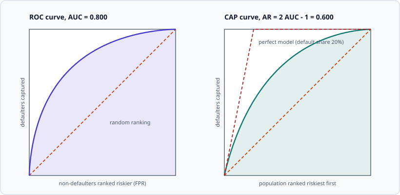

# 02. Discrimination

Discrimination asks whether the model ranks defaulters as riskier than non-defaulters. It says nothing about
calibration: multiplying every PD by two leaves every ranking statistic unchanged.

Inputs are risk-oriented: a higher value means a riskier obligor (a PD, a risk score, or a grade number where
higher is worse). With $A$ the defaulters and $B$ the non-defaulters,

$$u_{a,b} = \begin{cases}1 & \text{risk}(a) > \text{risk}(b)\\ \tfrac12 & \text{risk}(a) = \text{risk}(b)\\ 0 & \text{risk}(a) < \text{risk}(b)\end{cases},\qquad \mathrm{AUC} = \frac{1}{|A|\,|B|}\sum_{a\in A}\sum_{b \in B} u_{a,b}.$$

This is the Mann-Whitney statistic scaled to [0, 1]: the probability that a randomly chosen defaulter is ranked
riskier than a randomly chosen non-defaulter (Hanley and McNeil 1982, Radiology 143(1), 29 to 36,
[doi:10.1148/radiology.143.1.7063747](https://doi.org/10.1148/radiology.143.1.7063747)). The ECB states the same
statistic with ratings where higher means better quality; the orientation is reversed, the value is identical.

## AUC with the ECB standard error (`disc.auc`, descriptive)

The structural components (DeLong placements) are

$$V_{10}(a) = \frac{1}{|B|}\sum_{b} u_{a,b},\qquad V_{01}(b) = \frac{1}{|A|}\sum_{a} u_{a,b},$$

both averaging to the AUC, and the variance used by the ECB (Annex 3.1 of the 2019 instructions) is

$$s^2 = \frac{\widehat{\mathrm{var}}(V_{10})}{|A|} + \frac{\widehat{\mathrm{var}}(V_{01})}{|B|}$$

with unbiased sample variances. The package computes the placements in $O(n \log n)$ by sorting. The result also
reports the Gini coefficient (the accuracy ratio) $2\,\mathrm{AUC} - 1$ and a normal 95% interval.

**AUC and the accuracy ratio.** BCBS WP14: "the area A under the ROC curve and the CAP accuracy ratio AR are
connected by means of the linear transformation AR = 2 A - 1. As a consequence, neither A nor AR depend on the
proportion of defaulters in the sample." The identity holds when both are computed on the same ranking with ties
treated consistently: half credit in the AUC and linear interpolation inside tied groups in the CAP. The package's
`cap_accuracy_ratio` computes AR from the CAP directly, and the test `test_auc_matches_pairwise_and_cap` checks
the identity to $10^{-12}$ on data with ties. Somers' D of the score with respect to the default indicator is the
same number (WP14; Somers 1962, [doi:10.2307/2090408](https://doi.org/10.2307/2090408)).

## AUC against the development AUC (`disc.auc_vs_initial`)

ECB 2019, section 2.5.4.1: with the AUC at initial validation treated as fixed,

$$S = \frac{\mathrm{AUC}_{init} - \mathrm{AUC}_{curr}}{s},\qquad p = 1 - \Phi(S).$$

- $H_0$: the AUC at development is smaller than the AUC in the observation period.
- Reject (discrimination deteriorated) when $p < \alpha$.
- For low-default portfolios the ECB allows pooling the current and two preceding periods, replacing each
  period's rating by its within-period cumulative rank fraction; callers pool before calling the test.

## DeLong test (`disc.delong`)

For a champion and a challenger scored on the same obligors (DeLong, DeLong and Clarke-Pearson 1988, Biometrics
44(3), 837 to 845, [doi:10.2307/2531595](https://doi.org/10.2307/2531595)): with $S_{10}$ and $S_{01}$ the sample
covariance matrices of the two models' placements across defaulters and non-defaulters,

$$\mathbf{S} = \frac{S_{10}}{|A|} + \frac{S_{01}}{|B|},\qquad z = \frac{\widehat{\mathrm{AUC}}_1 - \widehat{\mathrm{AUC}}_2}{\sqrt{\mathbf{S}_{11} + \mathbf{S}_{22} - 2\mathbf{S}_{12}}},$$

asymptotically standard normal under $H_0$: equal AUCs; two-sided. When the two rankings are identical the
variance is zero and the result is "not evaluated". The ECB test above compares against a fixed number; DeLong
compares two models on one sample, which is the challenger question.

## Kolmogorov-Smirnov separation (`disc.ks`, descriptive)

$\mathrm{KS} = \sup_s |F_D(s) - F_{ND}(s)|$ between the risk distributions of defaulters and non-defaulters. Its
p-value tests identical distributions, that is no discrimination at all, which is rarely the question in
validation; the measure is reported as a separation statistic.

## Intervals

`bootstrap_ci` resamples defaulters and non-defaulters separately (stratified), so every replicate keeps the
observed default count, and returns a percentile interval for any statistic. No regulatory source prescribes the
number of replicates; the default is 2,000 and the seed makes the interval reproducible.
