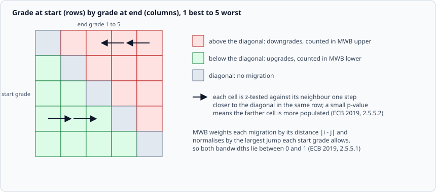

# 03. Rating-system stability

Three statistics from the ECB's 2019 instructions (section 2.5.5) describe how obligors move between grades and
how they concentrate in them. Grades are numbered $1..K$ from best to worst (non-default grades only);
$N_{ij}$ counts obligors in grade $i$ at the start of the period and grade $j$ at its end, $N_i = \sum_j N_{ij}$,
$p_{ij} = N_{ij}/N_i$.

## Matrix weighted bandwidth (`rating.mwb`, descriptive)

$$\mathrm{MWB}_{upper} = \frac{1}{M_{u}}\sum_{i=1}^{K-1}\sum_{j=i+1}^{K}|i-j|\,N_i\,p_{ij},\qquad \mathrm{MWB}_{lower} = \frac{1}{M_{l}}\sum_{i=2}^{K}\sum_{j=1}^{i-1}|i-j|\,N_i\,p_{ij},$$

$$M_{u} = \sum_{i=1}^{K-1}\max(|i-K|,|i-1|)\,N_i\sum_{j=i+1}^{K}p_{ij},\qquad M_{l} = \sum_{i=2}^{K}\max(|i-K|,|i-1|)\,N_i\sum_{j=1}^{i-1}p_{ij}.$$

Upper counts movements toward worse grades, lower toward better ones. The normalisation makes each lie in
[0, 1]: 0 when nobody moves, 1 when every mover jumps as far as its starting grade allows. The ECB reports both at
portfolio level and attaches no test; the package's metric is the larger of the two and reports both.

## Migration matrix z-tests (`rating.migration_ztests`)

Transition frequencies should not increase moving away from the diagonal. For a cell below the diagonal
($j < i$) the ECB compares it with its neighbour $j+1$, closer to the diagonal:

$$z_{ij} = \frac{p_{i,j+1} - p_{ij}}{\sqrt{\dfrac{p_{ij}(1-p_{ij})}{N_i} + \dfrac{p_{i,j+1}(1-p_{i,j+1})}{N_i} + \dfrac{2\,p_{ij}\,p_{i,j+1}}{N_i}}},$$

and above the diagonal ($j > i$) with $j+1$ replaced by $j-1$. The p-value is $\Phi(z_{ij})$; a small value means
the farther cell is significantly more populated than its closer neighbour. A cell whose variance is zero is
"missing", as in the ECB template.

The ECB does not specify control for testing many cells at once. The package reports every cell's $z$, raw
p-value and Holm-adjusted p-value (Holm 1979), uses the smallest adjusted p-value as the result's p-value (a
family-wise reading) and the number of raw rejections as the statistic. The adjustment is the package's addition
and is labelled as such.

## Concentration in grades (`rating.hhi`)

With $R_i$ the relative frequency of grade $i$ (by number of obligors, or by exposure for the index),

$$CV = \sqrt{K\sum_{i=1}^{K}\Big(R_i - \frac1K\Big)^2},\qquad HI = 1 + \frac{\log\big((CV^2 + 1)/K\big)}{\log K}.$$

$HI$ is 0 for a uniform distribution and 1 when every obligor sits in one grade. The ECB tests whether
concentration increased since development:

$$p = 1 - \Phi\!\left(\frac{\sqrt{K-1}\,(CV_{curr} - CV_{init})}{\sqrt{CV_{curr}^2\,(0.5 + CV_{curr}^2)}}\right),$$

$H_0$: the current Herfindahl index is lower than at development; reject (concentration increased) when
$p < \alpha$. The ECB cites Miller (1991), Communications in Statistics, Theory and Methods 20(10), 3351 to 3363,
for the distribution of the coefficient of variation; its DOI was not verified. When the current distribution is
uniform ($CV = 0$) the statistic is undefined and the result is not evaluated.
