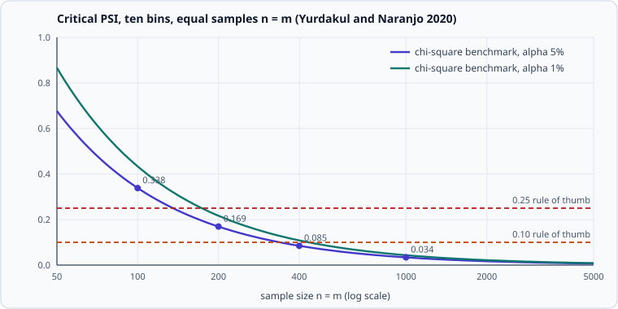

# 04. Population and characteristic stability

Stability asks whether the population the model now scores still resembles the one it was built on. A model can
be well calibrated on its development sample and wrong on a population that has moved.

## Population stability index (`stability.psi`) and characteristic stability index (`stability.csi`)

For $B$ fixed bins with development proportions $e_i$ and current proportions $a_i$:

$$\mathrm{PSI} = \sum_{i=1}^{B}(a_i - e_i)\ln\frac{a_i}{e_i},$$

the symmetrised Kullback-Leibler divergence. The CSI is the same formula on one model input's bins (pass the
characteristic's name as `segment`).

**The conventional bands.** PSI below 0.10 "little change", 0.10 to 0.25 "moderate change", 0.25 or more
"significant change, action required". These benchmarks "are used without reference to statistical type I or
type II error rates" (Yurdakul and Naranjo 2020, *Statistical properties of the population stability index*,
Journal of Risk Model Validation 14(4), 89 to 100, [doi:10.21314/JRMV.2020.227](https://doi.org/10.21314/JRMV.2020.227)).

**The benchmark that controls the error.** With development and current sample sizes $n$ and $m$, Yurdakul and
Naranjo show that $(1/n + 1/m)^{-1}\,\mathrm{PSI}$ is approximately $\chi^2_{B-1}$, so $E[\mathrm{PSI}] \approx
(1/n + 1/m)(B - 1)$ and a test of $H_0$: identical binned distributions rejects when

$$\mathrm{PSI} > \Big(\frac1n + \frac1m\Big)\,\chi^2_{1-\alpha,\,B-1}.$$

Their Table 2 ($B = 10$, $\alpha = 5\%$, $\chi^2_{0.95, 9} = 16.92$) gives 0.338, 0.169, 0.085 and 0.034 for
$n = m$ = 100, 200, 400 and 1,000, reproduced by `psi_benchmark` (test `test_psi_chi2_benchmark`). Their findings:
the 0.10 rule has too large a type I error unless both samples exceed about 400; the 0.25 rule is too
conservative above about 200; the power of fixed-threshold rules falls as samples grow.

The package reports both: the light follows the chi-square p-value, and the conventional band appears in the
result's notes, labelled as a rule of thumb.

**Their simulation, reproduced (0.03.000).** Yurdakul and Naranjo's Table 4 measures the rejection rates of PSI > 0.10,
PSI > 0.25 and the chi-square benchmark over 10,000 runs: a base sample of $N(0, 64)$, a target shifted by 0, 1/4 or 1/2
standard deviation, ten bins at the base population's deciles, six pairs of sample sizes. The harness reproduces 53 of
its 54 cells within 3.29 combined standard errors (`test_yurdakul_naranjo_table4`, the [two-sample
generator](../generators/04_drift-and-ratings.md)). The cell it does not reproduce is $m = 100$, $n = 400$, shift 1/2,
PSI > 0.25: printed 0.787, measured 0.817 (0.8175 at 20,000 runs). The paper does not say how it treats an empty bin,
which this cell meets in 2.8% of the runs, but no treatment explains the gap: flooring at half an observation gives
0.8175, dropping empty bins 0.8075, adding one half to every bin 0.7406 (and breaks the other rows).

| $n = m$, no shift | PSI > 0.10 | PSI > 0.25 | Chi-square benchmark at 5% |
|---|---|---|---|
| 100 | 85.3% | 23.4% | 7.67% |
| 400 | 2.1% | 0.0% | 5.47% |
| 2,000 | 0.0% | 0.0% | 4.67% |

Measured with 4,000 repetitions: the 0.10 band raises a false alarm in most samples of 100, the benchmark exceeds its
level at 100 (Yurdakul and Naranjo print 0.076) and holds it from 400.

**Implementation choices, stated.**

- Bins must be fixed before the current sample is seen. `quantile_edges` places them at the development sample's
  quantiles, with open outer edges so every current value falls in a bin; Yurdakul and Naranjo note that bins defined on
  base percentiles make PSI asymmetric in the two samples. The benchmark assumes fixed bins, yet measured on equal
  samples the size with the development sample's own deciles is the same within Monte Carlo error as with population
  deciles (7.45% against 7.67% at $n = m = 100$, 5.03% against 5.47% at 400, 4.98% against 4.67% at 2,000): the
  randomness of the edges carries the development sample's variability into the bin contents.
- An empty bin would make the logarithm infinite. Its count is floored at half an observation of its own sample (a
  continuity correction); the result counts how many bins were floored.

## Chi-square test of homogeneity (`stability.chi2`)

$X^2 = \sum_{g \in \{dev, cur\}}\sum_i (O_{gi} - E_{gi})^2/E_{gi}$ on the $2 \times B$ table, $\chi^2_{B-1}$ under
$H_0$. Asymptotically it plays the same role as the PSI benchmark. Computed with SciPy's `chi2_contingency` without
continuity correction. Measured size 5.33% at 5% with two samples of 2,000; the PSI's benchmark 5.73%, the CSI's 4.83%
and the Kolmogorov-Smirnov test's 4.72% on the same design.

## Two-sample Kolmogorov-Smirnov (`stability.ks`)

For a continuous variable, $\sup_x |F_{dev}(x) - F_{cur}(x)|$ with SciPy's `ks_2samp` p-value; $H_0$: both
samples come from one continuous distribution.

## Wasserstein-1 distance (`stability.wasserstein`, descriptive)

$W_1(F, G) = \int |F(x) - G(x)|\,dx$, in the variable's own units. No regulatory source sets a threshold for it.

## How open-source monitors set defaults (for comparison, not adopted)

Evidently uses KS or chi-square with $p \le 0.05$ for samples up to 1,000 rows and Wasserstein or Jensen-Shannon
distances of at least 0.1 above that ([docs](https://docs.evidentlyai.com/metrics/explainer_drift)); ING's popmon
colours the standardised deviation from a reference, green below 4, yellow 4 to 7, red above 7
([docs](https://popmon.readthedocs.io/en/latest/comparisons.html)). Both are conventions; this package keeps
thresholds in the policy file.
