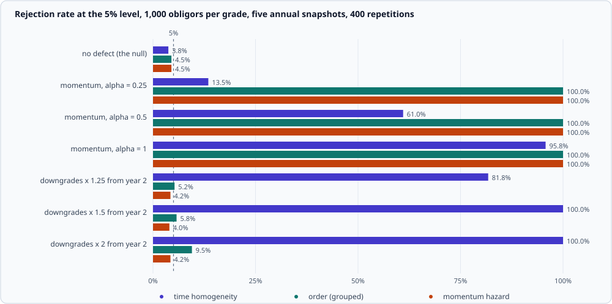

# Rating transitions

A rating system is validated through its migrations as much as through its default rates. The supervisor's
guidelines say why: "Philosophies sensitive to economic conditions tend to estimate PDs that are better predictors of
each year's default rates ... migrations among grades will be more likely in rating systems which are more sensitive
to economic conditions. These patterns should be taken into account when assessing the results of back-testing"
(EBA/GL/2017/16, paragraph 66(c)); institutions analyse their rating philosophy through "(a) design of risk drivers;
(b) migration across grades or pools; (c) changes in the yearly default rates of each grade or pool" (paragraph 67);
and a through-the-cycle grade's PD may be estimated with "migration matrices for the purpose of estimating long-run
average default rates covering the full historical observation period" (Table 1, "TTC E"). The long-run average
default rate is "the observed average of the one-year default rates" (paragraph 84), and the one-year default rate keeps
in its denominator the obligors that migrated or whose obligations were closed (paragraphs 73 and 76).

`riskvalidation.transitions` estimates migration matrices from the two kinds of data a validator gets (count matrices,
as ESMA's CEREP publishes them, and obligors' paths), turns a matrix into a generator when it can and says why when it
cannot, bounds a PD by grade, measures mobility, and computes the through-the-cycle portfolio a matrix implies.
Four registered tests ask whether the chain is Markov and time-homogeneous, with their size and power measured on the
[rating-path generator](generators/05_rating-paths.md), where the truth is known.

| Page | Contents |
|---|---|
| [01. Estimating a migration matrix](transitions/01_estimators.md) | count matrices and paths; the cohort estimator (Anderson and Goodman (2.8), (2.9)) with withdrawals removed (the industry standard) or kept (EBA paragraph 76); the duration estimator; Aalen-Johansen; the cohort's zero PDs on a known generator |
| [02. From a matrix to a generator](transitions/02_embedding-and-em.md) | the embedding problem (Israel, Rosenthal and Wei: the log series, Theorem 3, the diagonal, weighted and JLT generators, monotonicity), their nine published distances reproduced; the EM generator of snapshot counts with Smith and dos Reis's closed-form E-step |
| [03. Is the chain Markov and time-homogeneous?](transitions/03_markov-tests.md) | time homogeneity (3.5), (3.8); the order of the chain (3.12); a matrix against a reference (3.1); rating momentum (dos Reis et al.'s hazard test); every form's size measured, and the power of each test against momentum and a recession regime |
| [04. Intervals and mobility](transitions/04_intervals-and-mobility.md) | Wald (2.2), Agresti-Coull (3.3) with the dependence correction (3.4), Jeffreys, the bootstraps of the duration PD; Schuermann and Hanson's Table 5 reproduced; exact coverage; Jafry and Schuermann's M_SVD and the trace index |
| [05. The TTC portfolio](transitions/05_ttc-portfolio.md) | Engelmann's propagation (9) and Theorem 1; his section 4 reproduced; the drift of an unstressed projection towards the matrix's own portfolio |

Measured in 0.04.000:

- The default form of each test holds its size on sparse rating tables where a printed form does not: the
  time-homogeneity likelihood ratio rejects 7.85% at 5%, the order chi-square on the full table 13.78%, the
  reference-matrix chi-square 3.02% at 1%; their defaults 4.85%, 4.80% and 4.05% at 5%.
- The time-homogeneity test rejects under momentum as well as under a regime change; the order and momentum tests
  separate the two.
- With one expected default, the Wald interval for a PD covers 63% of the time; Agresti-Coull and Jeffreys 98%.
- With 1,000 obligors in a grade whose true PD is 2.5bp, the cohort PD is zero in 78% of years; the duration PD never.
- Three published results reproduce to the printed digits: Israel et al.'s distances, Schuermann and Hanson's Table 5,
  Engelmann's TTC portfolio and projections.

