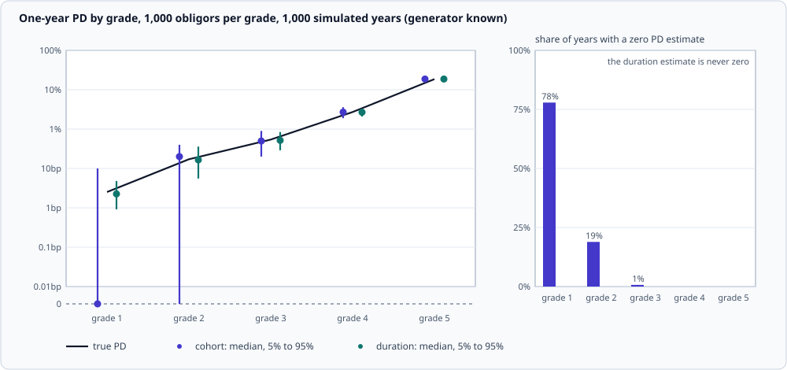

# 01. Estimating a migration matrix

`riskvalidation.transitions.estimators`: `cohort`, `pooled_cohort`, `duration_generator`, `aalen_johansen`

## 1. Two kinds of data

A migration matrix reaches a validator in one of two forms, and the form decides which estimators exist.

**Count matrices.** ESMA's central repository of rating statistics (CEREP) publishes the agencies' EU entities'
statistics as aggregates only, built on "a stock concept model, so that intra-period rating activity is derived from a
comparison of ratings at the beginning and the end of a period" (ESMA, *CEREP Help File*, ESMA65-8-10634). Its
transition page shows "the number of transitions from one category or notch value to another over the selected
statistics period or whether a rating of the initial cohort is withdrawn at the end of the statistics period": rows are
the state at the beginning, columns the state at the end, plus a "Withdrawals" column. Nothing between the two dates is
published, so only the cohort estimator can be computed from it.

**Paths.** A bank's own rating history, or a generator's, gives each obligor's states with their dates. The package
takes them as a segment table, one row per stay of an obligor in a state: `obligor`, `start`, `stop`, `state` and
`to`, the state entered at `stop`, or `CENSORED_END` (-1, observation ended) or `WITHDRAWN` (-2). From paths every
estimator below can be computed, and the cohort counts too (the generator's snapshots, [rating paths](../generators/05_rating-paths.md)).

Conventions throughout: states are ordered best to worst, default last and absorbing; a withdrawal is a separate
column, never a grade.

## 2. The cohort estimator

Anderson and Goodman, *Statistical inference about Markov chains*, Annals of Mathematical Statistics 28(1), 89 to 110
(1957), [doi:10.1214/aoms/1177707039](https://doi.org/10.1214/aoms/1177707039), section 2.2: for a chain observed at
dates $t = 0, \dots, T$ with $n_{ij}(t)$ obligors moving from $i$ at $t - 1$ to $j$ at $t$,

$$\hat p_{ij} = \frac{n_{ij}}{n_i^*} = \frac{\sum_{t} n_{ij}(t)}{\sum_t \sum_k n_{ik}(t)} \quad (2.8), \qquad
\hat p_{ij}(t) = \frac{n_{ij}(t)}{n_i(t - 1)} \quad (2.9).$$

(2.8) is the stationary chain's estimator, pooled over periods: "add the corresponding entries in the two-way tables
... The estimate of $p_{ij}$ is the $i, j$ entry of the table of $n_{ij}$'s divided by the sum of the entries in the
$i$th row"; (2.9) is the estimator of one period. `cohort(counts, withdrawn)` is (2.9) on one matrix,
`pooled_cohort(counts_by_period, withdrawn_by_period)` is (2.8). Section 2.4 of the paper gives the asymptotics the
tests of [page 03](03_markov-tests.md) rest on: each row behaves as an independent multinomial sample of its size.

Schuermann and Hanson, *Estimating probabilities of default*, Federal Reserve Bank of New York Staff Report 190 (2004)
describe the industry's use: "Suppose there are $N_i$ firms in rating category $i$ at the beginning of the year, and
$N_{ij}$ migrated to grade $j$ by year-end. An estimate of the transition probability is $P_{ij} = N_{ij} / N_i$ ... Any
movements within the year are not accounted for."

### Withdrawals: two definitions of a default rate

Schuermann and Hanson, footnote 4: "The method which has emerged as an industry standard treats transitions to NR as
non-informative. The probability of transitions to NR is distributed among all states in proportion to their values.
This is achieved by gradually eliminating companies whose ratings are withdrawn." Removing the withdrawn ratings from
a row and renormalising it does exactly that: `cohort(..., treatment="exclude")`, the default.

The EBA's guidelines on PD estimation (EBA/GL/2017/16, 20 November 2017) define the one-year default rate differently.
Paragraph 73: the denominator is "the number of non-defaulted obligors with any credit obligation observed at the
beginning of the one-year observation period", the numerator "all those obligors considered in the denominator that
had at least one default event during the one-year observation period". Paragraph 76: an obligor stays in the
denominator "also in the case of a migration to a different rating grade ... or where the corresponding credit
obligations were sold, written off, repaid or otherwise closed during the observation period", and institutions
"should analyse whether such migrations or sales of credit obligations bias the default rate". Paragraph 77: "each
defaulted obligor is counted only once". `cohort(..., treatment="state")` keeps the withdrawn ratings as an absorbing
extra state, so each row shows how much of it left the sample, and the default column keeps its full denominator.

CEREP publishes both sides. Its "Transition Matrices - Defaults" page counts "the number of defaults that happened to
ratings belonging in the initial cohort", over "the total number of ratings belonging in the initial cohort ...
(regardless of whether they include a default or not)": a rating withdrawn after defaulting still counts, as paragraph
76 wants, but "In case there are multiple default events in a statistics period, all default events will be counted"
and it counts ratings, not obligors (against paragraph 77). The transition matrix page instead puts a rating withdrawn
by the end of the period in "Withdrawals", whatever happened before. The two cohort default rates differ, and the gap
measures the withdrawal treatment. When withdrawal is informative (ratings about to default are withdrawn more often),
removing withdrawals understates the PD; the [rating-path generator](../generators/05_rating-paths.md) plants exactly
that defect.

## 3. The duration estimator

For a time-homogeneous chain observed continuously, the likelihood of a generator $Q$ is (Smith and dos Reis 2018,
citing Küchler and Sørensen 1997)

$$L_t(Q) = \exp\Big(\sum_{i}\Big[\sum_{j \ne i} \log(q_{ij}) K_{ij}(t) - S_i(t) \sum_{j \ne i} q_{ij}\Big]\Big),$$

with $K_{ij}(t)$ the jumps from $i$ to $j$ in $[0, t]$ and $S_i(t)$ the time spent in $i$. It is maximised by

$$\hat q_{ij} = \frac{K_{ij}}{S_i}, \qquad \hat q_{ii} = -\sum_{j \ne i} \hat q_{ij},$$

the estimator of Lando and Skødeberg (2002, Journal of Banking and Finance 26(2-3), 423 to 444,
[doi:10.1016/S0378-4266(01)00228-X](https://doi.org/10.1016/S0378-4266(01)00228-X)). The PD by grade at horizon $t$ is
the default column of $\exp(t\hat Q)$. Schuermann and Hanson: "The duration approach counts all rating changes over the
course of the year and divides by the time spent in the starting state or rating to obtain the migration intensity
which is transformed into a migration probability ... firms which end the period in an NR status still contribute to
the estimated probabilities up until the date when they transition to NR." The difference in exposure is not small:
"the total number of firm years spent in 'BBB' during 2002 was 857 whereas $N_{BBB}$ = 804 under the cohort approach".

`duration_generator(paths, n_states)` returns the generator with the jumps $K$ and the holding times $S$; a state never
occupied keeps a zero row and is listed in `unobserved`.

**Rare cells.** The cohort estimator puts zero on every move no obligor made within a period, even where a sequence of
moves makes it possible. On S&P's US ratings of 1981 to 2002, with no AAA, AA+ or AA default within a year, "the cohort
estimate is identically equal to zero, in contrast to the duration estimate where $PD_{AAA}$ = 0.02bp, $PD_{AA+}$ =
0.05bp and $PD_{AA}$ = 0.71bp" (Schuermann and Hanson). A downgrade to AA and a default later in the year is a path the
duration estimator sees and the cohort estimator does not.

## 4. Without time homogeneity: Aalen-Johansen

Aalen and Johansen (1978), *An empirical transition matrix for non-homogeneous Markov chains based on censored
observations*, Scandinavian Journal of Statistics 5(3), 141 to 150: the transition matrix between $s$ and $t$ is the
product integral

$$\hat P(s, t) = \prod_{s < u \le t} \big(I + d\hat A(u)\big), \qquad d\hat A_{ij}(u) = \frac{dN_{ij}(u)}{Y_i(u-)},
\quad d\hat A_{ii}(u) = -\sum_{j \ne i} d\hat A_{ij}(u),$$

over the observed transition times $u$, with $Y_i(u-)$ the obligors in $i$ just before $u$ (here those with
`start` < $u$ <= `stop`). Schuermann and Hanson: it "imposes fewer assumptions ... by allowing for time
non-homogeneity", and they report that Jafry and Schuermann (2004) find it "generates annual transition matrices that
are statistically indistinguishable from their parametric counterparts" (that paper is not open access and was not
read here). `aalen_johansen(paths, n_states, s, t)` returns the matrix and the number of transition times.

## 5. Measured on a known generator

The size study's Markov chain (five grades and default, the top grade's one-year PD 2.52bp, the second's 17.1bp),
1,000 obligors per grade, 1,000 simulated years (`scripts/make_doc_figures.py`). The cohort PD of the top grade is
exactly zero in 78% of the years, as it must be: with 0.25 expected defaults the binomial gives no default with
probability $e^{-0.25} \approx 0.78$. The second grade's is zero in 19% of the years. The duration estimate is never
zero and its 5% to 95% range brackets the truth in every grade. CEREP's EU entities have 2,000 to 8,500 corporate
ratings in a calendar-year cohort spread over some twenty notches, so a best grade with a few hundred ratings is the
normal case, and the cohort PD of its best grades is zero in most years.

`tests/test_transitions.py::test_duration_and_aalen_johansen_recover_truth` (RV-402) checks the duration and
Aalen-Johansen estimators against the generator's truth within four Monte Carlo standard errors, and that the cohort
estimator puts zero on the rare cells the truth makes positive.

## 6. Reconciliation with the transitionMatrix package

Open Risk's `transitionMatrix` 0.5.1 (Apache-2.0, `pip install "riskvalidation[transitions]"`) is the independent
reference of the cohort estimator, used in the tests only; the engine never imports it.
`tests/test_transitions_reconciliation.py` (RV-415) feeds one seeded panel (600 entities, 6 dates, four grades and
default, 157 withdrawals) to `pooled_cohort` and `cohort` and to the package's `CohortEstimator.fit`
(`transitionMatrix/estimators/cohort_estimator.py` l.48), and compares them element-wise within 1e-12. The count-averaged
matrix of the package is Anderson and Goodman's (2.8) and equals the engine's `treatment="state"` matrix, the withdrawn
share being what the package's rows lack; the measured largest difference is 0.0. The industry treatment (`"exclude"`)
has no counterpart in the package; it equals the package's matrix renormalised on the performing columns, which is how
the engine defines it.

Where the conventions differ the tests state both values and loosen nothing:

- an empty row is NaN in the engine (listed in `empty_rows`) and zeros in the package;
- the package reports what a panel shows after default (a reinstatement is a migration out of default); the engine
  sets the default row to the unit vector;
- the package handles the last record of its last entity twice (l.150 to l.155): a difference of up to 1.6e-3 on this
  panel, reproduced exactly by counting that migration again; the tests end the panel with an absorbing default entity
  so the comparison is clean;
- the package has no maximum likelihood generator from paths (`duration_generator`): its `generator` (`model.py` l.231)
  is the matrix logarithm and its `KaplanMeierEstimator` is an empty class, so the duration estimator is not reconciled
  against it;
- its Aalen-Johansen estimator divides by the risk set after the exits (`aalen_johansen_estimator.py` l.189, l.201): with
  four obligors and one move the increment is 1/3, the engine's is 1/4, the textbook Nelson-Aalen value.

## 7. What not to claim

- CEREP's figures are the agencies' EU entities' statistics as ESMA computes them, not the agencies' own studies;
  every figure must say which entity, scope, horizon and default definition it follows.
- An agency's PD by grade is not a bank's PD, and a matrix estimated here is not a supervisory parameter.
- A Markov fit that passes on one-year aggregates says nothing about the paths CEREP does not publish (order,
  momentum: [page 03](03_markov-tests.md)).
