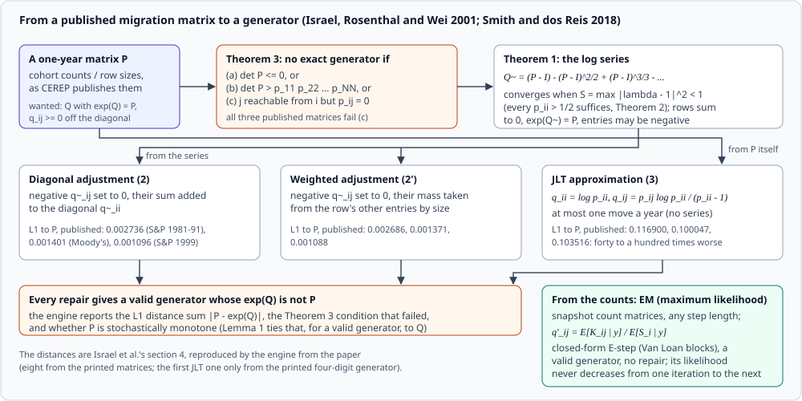

# 02. From a matrix to a generator: the embedding problem and the EM generator

`riskvalidation.transitions.embedding`: `log_series`, `embedding_diagnostics`, `diagonal_adjustment`,
`weighted_adjustment`, `jlt_generator`, `generator`, `l1_distance`, `monotonicity_violations`, `is_generator`;
`riskvalidation.transitions.em`: `em_generator`

## 1. Why a generator

A one-year matrix $P$ answers one question, the distribution of grades a year later. A continuous-time chain with
generator $Q$ (non-negative off-diagonal entries, rows summing to zero) answers every horizon at once,
$P(t) = \exp(tQ)$: the PD by grade over three months or seven years, a semester matrix from an annual one, and a
positive probability for a move no obligor made in the sample but a sequence of moves allows. Turning a published $P$
into a $Q$ is the embedding problem; estimating $Q$ from the counts behind $P$ is a likelihood problem.

## 2. Israel, Rosenthal and Wei (2001)

R. B. Israel, J. S. Rosenthal, J. Z. Wei, *Finding generators for Markov chains via empirical transition matrices,
with applications to credit ratings*, Mathematical Finance 11(2), 245 to 265,
[doi:10.1111/1467-9965.00114](https://doi.org/10.1111/1467-9965.00114), read in the authors' version.

**The log series (Theorem 1).** With $S = \max\{(a - 1)^2 + b^2 : a + bi \text{ an eigenvalue of } P\}$, if $S < 1$
the series

$$\tilde Q = (P - I) - \frac{(P - I)^2}{2} + \frac{(P - I)^3}{3} - \frac{(P - I)^4}{4} + \cdots \qquad (1)$$

"converges geometrically quickly, and gives rise to an $N \times N$ matrix $\tilde Q$ having row-sums 0, such that
$\exp(\tilde Q) = P$ exactly". Theorem 2: if every $p_{ii} > 1/2$ then $S < 1$, and $P$ has at most one generator
(Cuthbert 1972, 1973). `log_series(P)` returns $\tilde Q$, the number of terms, $S$ and the distance to SciPy's matrix
logarithm as a cross-check.

**When no generator exists (Theorem 3).** $P$ has no exact generator if (a) $\det P \le 0$, or (b)
$\det P > \prod_i p_{ii}$, or (c) some state $j$ is accessible from $i$ while $p_{ij} = 0$. Condition (c) is the usual
one for rating matrices: a published matrix with a zero AAA-to-default cell, where AAA can reach default through other
grades, cannot be the exponential of any generator. `embedding_diagnostics(P)` reports $S$, the three conditions,
whether the series has negative off-diagonal entries, and stochastic monotonicity.

**Repairs.** $\tilde Q$ may have negative off-diagonal entries. The diagonal adjustment "replacing these negative
entries with 0, and adding the appropriate value back into the corresponding diagonal entry",

$$q_{ij} = \max(\tilde q_{ij}, 0)\ (j \ne i), \qquad q_{ii} = \tilde q_{ii} + \sum_{j \ne i} \min(\tilde q_{ij}, 0)
\qquad (2);$$

the weighted adjustment, with $G_i = |\tilde q_{ii}| + \sum_{j \ne i} \max(\tilde q_{ij}, 0)$ and
$B_i = \sum_{j \ne i} \max(-\tilde q_{ij}, 0)$: $q_{ij} = 0$ where $j \ne i$ and $\tilde q_{ij} < 0$,
$q_{ij} = \tilde q_{ij} - B_i |\tilde q_{ij}| / G_i$ otherwise when $G_i > 0$, $q_{ij} = \tilde q_{ij}$ when $G_i = 0$
(2'). Neither keeps $\exp(Q) = P$. Jarrow, Lando and Turnbull's approximation, which assumes at most one move a year,

$$q_{ii} = \log p_{ii}, \qquad q_{ij} = \frac{p_{ij} \log p_{ii}}{p_{ii} - 1} \quad (j \ne i) \qquad (3).$$

`generator(P, method="series" | "diagonal" | "weighted" | "jlt")` returns the generator, whether it is valid, and the
distance the paper reports, the L1 norm $\sum_{ij} |P - \exp(Q)|_{ij}$.

**Stochastic monotonicity (Lemma 1, after Jarrow, Lando and Turnbull 1997, p. 495).** For a valid generator,
$\sum_{j \ge k} p_{ij}$ non-decreasing in $i$ for every $k$ (a worse grade is never less likely to end at or below any
grade) is equivalent to $\sum_{j \ge k} q_{ij} \ge \sum_{j \ge k} q_{i+1, j}$ for all $i, k$ with $k \ne i + 1$.
`monotonicity_violations(P)` lists the pairs of rows and the tail where it fails.

## 3. The published distances, reproduced

| Matrix | JLT (3) | series + (2) | series + (2') |
|---|---|---|---|
| S&P 1981 to 1991, as in Jarrow et al. (1997) Table 3 | 0.116900 | 0.002736 | 0.002686 |
| Moody's 1980 to 1998 | 0.100047 | 0.001401 | 0.001371 |
| S&P 1999 (a longer period) | 0.103516 | 0.001096 | 0.001088 |

`tests/test_reproductions.py::test_israel_rosenthal_wei` reads the three matrices from the paper and reproduces eight
of the nine distances to the printed six digits from the printed matrices. The ninth, the first matrix's JLT distance
0.116900, does not follow from equation (3) on the printed $P$ (0.116477), but follows exactly from the paper's printed
four-digit $Q_{JLT}$: that matrix is not (3) applied to the printed $P$ (its row 1 prints 0.1019 and 0.0031 where (3)
gives 0.1020 and 0.0032), most likely carried from Jarrow et al.'s computation on their unrounded data. The series
generator of the first matrix reproduces to the printed six decimals (for example $\tilde q_{12}$ = 0.107466,
$\tilde q_{16}$ = -0.000409, $\tilde q_{77}$ = -0.435344), as do Theorem 3(c) for all three matrices and the
violation of Lemma 1 in the first ($\sum_{j \ge 4} p_{6j}$ = 0.9949 against $\sum_{j \ge 4} p_{7j}$ = 0.9885). The
matrices are S&P's and Moody's data reprinted in the paper, so the test reads the paper from the device data root
(`RISKVALIDATION_DATA/israel-rosenthal-wei-2001/wei.pdf`) and skips without it; the repository carries no agency
matrix.

The repairs land within a few thousandths of $P$; JLT's approximation is forty to a hundred times further. A repaired
generator is still a model choice: the distance says how far $\exp(Q)$ is from the published matrix, not how far $Q$
is from the truth, which only a generator with a known $Q$ can measure (section 5).

## 4. The EM generator: maximum likelihood from snapshot counts

When the counts behind $P$ are available (CEREP publishes them), the generator can be estimated by maximum likelihood
instead of repaired. G. Smith, G. dos Reis, *Robust and consistent estimation of generators in credit risk*,
Quantitative Finance (2018), [doi:10.1080/14697688.2017.1383627](https://doi.org/10.1080/14697688.2017.1383627), read
in the final author version (arXiv 1702.08867), section 2, presenting the algorithm of Bladt and Sørensen (2005,
JRSS B 67(3)).

The complete-data likelihood is the duration likelihood of [page 01](01_estimators.md). EM maximises the likelihood of
the snapshots $y$ by iterating

$$q'_{ij} = \frac{E_Q[K_{ij}(t) \mid y]}{E_Q[S_i(t) \mid y]} \qquad (2.3),$$

where the expectations are given in closed form by Van Loan's block exponentials (their Proposition 2.4): with
$e_i$ the $i$th unit vector and the $2h \times 2h$ matrices

$$C_\gamma^{(ij)} = \begin{pmatrix} Q & q_{ij} e_i e_j^\top \\ 0 & Q \end{pmatrix}, \qquad
C_\phi^{(i)} = \begin{pmatrix} Q & e_i e_i^\top \\ 0 & Q \end{pmatrix},$$

$$E_Q[K_{ij} \mid y] = \sum_{s} \frac{\big(\exp\{C_\gamma^{(ij)} (t_{s+1} - t_s)\}\big)_{y_s,\, h + y_{s+1}}}
{\big(\exp\{Q (t_{s+1} - t_s)\}\big)_{y_s y_{s+1}}}, \qquad
E_Q[S_i \mid y] = \sum_{s} \frac{\big(\exp\{C_\phi^{(i)} (t_{s+1} - t_s)\}\big)_{y_s,\, h + y_{s+1}}}
{\big(\exp\{Q (t_{s+1} - t_s)\}\big)_{y_s y_{s+1}}}.$$

For aggregated counts $n_{ab}$ over a step of length $\Delta$ the sums run over $(a, b)$ weighted by $n_{ab}$, so the
maximum likelihood generator of CEREP's semester or annual matrices is computable without paths.
`em_generator(steps)` takes a sequence of `{"counts", "dt"}`, adds the steps of one length first (the E-step is linear
in the counts), and returns the generator, the observed log-likelihood $\sum n_{ab} \log P_{ab}(\Delta)$ of every
iteration (it never decreases), the expected jumps and holding times of the last E-step, and whether it converged.
Their Theorem 2.10: from a valid start the iterates converge to a stationary point of the likelihood or go to the
boundary.

**The start.** An entry that starts at zero stays at zero, so the start must give every allowed move a positive rate.
Smith and dos Reis start from a generalisation of the QOG algorithm (Kreinin and Sidelnikova 2001) and take "any zero
entries not in the final row to be a small number ($10^{-5}$, say) unless there are zero observed transitions". The
engine starts from the pooled one-step rates plus $0.05/(m - 1)$ on every move from a non-default state, and accepts
any `q0`. QOG and the Gibbs sampler of Bladt and Sørensen (posterior $\Gamma(K_{ij} + \alpha_{ij}, 1/(S_i + \beta_i))$)
are described in Smith and dos Reis's section 3 and are not implemented here (the QOG algorithm's own paper was not
read).

**A claim to measure.** Smith and dos Reis's abstract: the EM "outperforms other known algorithms in several metrics,
in particular, with much less overestimation of probabilities of default in higher ratings than other statistical
algorithms". On a generator with a known $Q$ each estimator's bias on the high grades' PDs is measurable; the
Contraste case C04 does it with the harness (finding F-EM-RARE).

`tests/test_transitions.py::test_em_generator` (RV-404) checks that the closed-form expected jumps under the true
generator agree with the jumps the simulated paths made (within four Poisson standard errors, over ten draws), that the
log-likelihood never decreases, that the result is a valid generator, and that from ten annual snapshots of 5,000
obligors it recovers the one-year PDs of the three lower grades within 15%.

## 5. What the distance does not say

The L1 distance of a repaired generator compares $\exp(Q)$ with the published $P$, which is itself an estimate with
sampling error in every cell; a distance of 0.001 can hide a generator whose rare entries are badly wrong. The engine
reports the distance, the Theorem 3 condition that failed, and monotonicity, and leaves the judgement of the repair to
a comparison against a known truth: on [the rating-path generator](../generators/05_rating-paths.md) the true $Q$ is
known and the estimators' errors are measured, not assumed.
