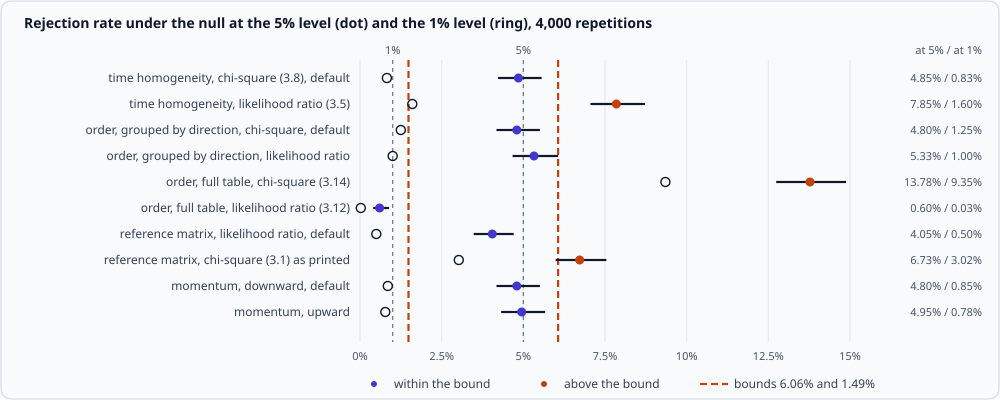
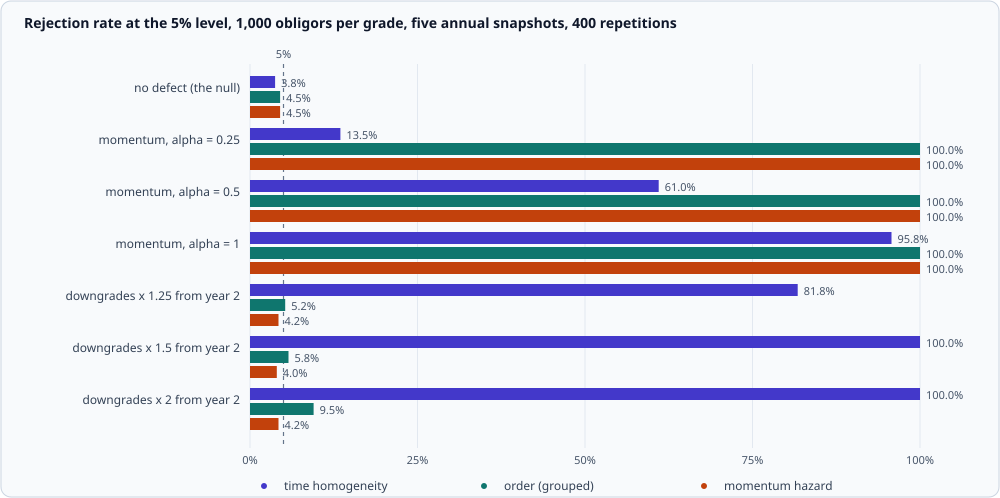

# 03. Is the chain Markov and time-homogeneous? Four registered tests

`riskvalidation.validation.transitions`: `rating.time_homogeneity`, `rating.markov_order`, `rating.matrix_reference`,
`rating.momentum` (family `transitions`, decision by p-value; thresholds in the policy file, amber below 5% and red
below 1%, version 2026.10.1)

A migration matrix used for PDs at several horizons, for a TTC estimate or for a stress-test projection assumes that
the chain is Markov (the next grade depends on the current grade only) and time-homogeneous (the same matrix every
year). Both are testable, and the four tests below each answer one part. The first three are Anderson and Goodman's,
*Statistical inference about Markov chains*, Annals of Mathematical Statistics 28(1), 89 to 110 (1957),
[doi:10.1214/aoms/1177707039](https://doi.org/10.1214/aoms/1177707039), section 3, read at the page images; the
fourth is the hazard test of dos Reis, Pfeuffer and Smith (2020). Their asymptotics assume every $p_{ij} > 0$, and
rating tables are sparse, so each test's default form was chosen by measurement (section 5).

## 1. Time homogeneity (section 3.2)

$H$: $p_{ij}(t) = p_{ij}$ for $t = 1, \dots, T$. The likelihood ratio and the contingency form are

$$\lambda = \prod_{t} \prod_{i,j} \left[\frac{\hat p_{ij}}{\hat p_{ij}(t)}\right]^{n_{ij}(t)} \quad (3.5), \qquad
\chi^2 = \sum_i \sum_{t,j} n_i(t - 1) \frac{\big[\hat p_{ij}(t) - \hat p_{ij}\big]^2}{\hat p_{ij}} \quad (3.8),$$

$\hat p_{ij}$ pooled over the periods (2.8) and $\hat p_{ij}(t)$ of one period (2.9); "$-2 \log \lambda$ is distributed
as chi-square with $(T - 1)[m(m - 1)]$ degrees of freedom when the null hypothesis is true", and (3.8) has the same.
Rows are independent, so the statistic is a sum over rows. The default row is absorbing and carries no information.
`rating.time_homogeneity(counts_by_period, form="chi2" | "lr")`, the chi-square by default; both forms are in
`extras`, with each row's contribution. It runs on CEREP's semester or annual count matrices directly.

## 2. Order: first against second (section 3.3)

From the obligors in $i$, then $j$, then $k$ at three consecutive dates ($n_{ijk}$),

$$\lambda = \prod_{i,j,k} \left(\frac{\hat p_{jk}}{\hat p_{ijk}}\right)^{n_{ijk}} \quad (3.12),$$

$-2 \log \lambda$ asymptotically chi-square with $m(m - 1)^2$ degrees of freedom; the contingency form (3.14) has
$(m - 1)^2$ for each middle state $j$. On rating data the full $m \times m \times m$ table is mostly empty, and both
forms fail (section 5). The default groups the previous and next states by direction (from a better grade, the same,
a worse one; to a better, the same, a worse one): a $3 \times 3$ table per middle grade where every cell has data, and
the grouping momentum acts on. `rating.markov_order(triplets, grouping="direction" | "none", form="chi2" | "lr")`.
It needs each obligor's three consecutive states, which CEREP's one-step aggregates do not hold: it runs on paths.

## 3. A matrix against a reference (section 3.1)

$$\chi^2 = \sum_i \sum_j n_i^* \frac{(\hat p_{ij} - p^0_{ij})^2}{p^0_{ij}} \quad (3.1),$$

chi-square with $m - 1$ degrees of freedom per row, $m(m - 1)$ over the rows; "a confidence region inverts it". The
validator's use: this year's counts against the development matrix, or a bank's counts against an agency's matrix.
The default is the likelihood-ratio analogue $2 \sum_{ij} n_{ij} \log(\hat p_{ij}/p^0_{ij})$, which holds its size
where (3.1) as printed does not (section 5). A move the reference makes impossible ($p^0_{ij} = 0$) that the counts
show rejects outright, with the moves listed. `rating.matrix_reference(counts, reference, form="lr" | "chi2")`.

## 4. Rating momentum (dos Reis, Pfeuffer and Smith 2020)

G. dos Reis, M. Pfeuffer, G. Smith, *Capturing model risk and rating momentum in the estimation of probabilities of
default and credit rating migrations*, Quantitative Finance (2020), read at arXiv 1809.09889v2. The effect: "an obligor
that has been recently downgraded into a certain rating is more likely to be downgraded further than other obligors
currently in that rating. Such an effect is referred to as (downward)-rating momentum. A similar effect may also appear
in upgrades; however, it is not as apparent." The test (their section 4.1, after Andersen et al. 1991 and Lando and
Skødeberg 2002) models the intensity of leaving the current state $i$ for firm $n$ as

$$\lambda_{in}(t) = q_i(t) \exp\big(c Z_n(t)\big), \qquad Z_n(t) = \begin{cases} 1 & \text{if firm } n \text{ was
downgraded to its current state,} \\ 0 & \text{otherwise,} \end{cases}$$

with an unspecified baseline $q_i(t)$ ("we are not assuming that the baseline is time homogeneous in the test"),
fitted by partial likelihood, which handles censored observations: "the Markov assumption is equivalent to the null
hypothesis $c = 0$". Their Table 2 on Moody's data: downward momentum coefficient 0.33010 (p-value below 0.0001),
upward momentum -0.01487 (p-value 0.68153), "consistent with those of Lando and Skodeberg (2002)".

`rating.momentum(paths, direction="down" | "up")` fits the Cox partial likelihood stratified by the current grade
(each grade its own baseline) on calendar time, an obligor at risk from its entry into the grade, the first stay
(the initial rating) with $Z = 0$; the statistic is the likelihood ratio for $c$, chi-square with one degree of
freedom, and the coefficient and hazard ratio are in `extras`. The model that generates momentum is on the
[rating-path generator's page](../generators/05_rating-paths.md).

## 5. Size, measured: which form is the default

Each test was run on the rating-path generator under the null (a time-homogeneous Markov chain, 1,000 obligors in each
of five grades, five annual snapshots), 4,000 repetitions at the test's seed in `tests/test_size.py`; the bound
consistent with a size of at most the level is 6.06% at 5% and 1.49% at 1%.

| Test, form | at 5% | at 1% | |
|---|---|---|---|
| time homogeneity, chi-square (3.8) | 4.85% | 0.83% | default |
| time homogeneity, likelihood ratio (3.5) | 7.85% | 1.60% | above the bound |
| order, grouped by direction, chi-square | 4.80% | 1.25% | default |
| order, grouped by direction, likelihood ratio | 5.33% | 1.00% | |
| order, full table, chi-square (3.14) | 13.78% | 9.35% | above the bound |
| order, full table, likelihood ratio (3.12) | 0.60% | 0.03% | almost never rejects |
| reference matrix, likelihood ratio | 4.05% | 0.50% | default |
| reference matrix, chi-square (3.1) as printed | 6.73% | 3.02% | above the bound |
| momentum, downward | 4.80% | 0.85% | default |
| momentum, upward | 4.95% | 0.78% | |

The forms agree where cells are well filled and part where they are not: the size study's chain has expected counts
below one in many cells of its best grades, as CEREP's cohorts do. On the full order table the two forms fail in
opposite directions, the chi-square rejecting 14% of the time at 5% and the likelihood ratio almost never; grouping by
direction gives every cell data, and both forms hold. For time homogeneity the likelihood ratio is the form that fails.
For the reference matrix it is the chi-square, for an arithmetic reason: a cell the reference gives $p^0$ = 0.00001
expects 0.01 moves among 1,000 obligors, and one observed move adds $(1 - 0.01)^2/0.01 \approx 98$ to the statistic.
Which form holds is a property of the data's sparsity, measured here for one design; on another design the harness
measures it again. Two seven-grade chains show how much: on the chain of Contraste's case C04 (the EM generator of
S&P's CEREP counts, cohorts of 75 to 1,814 ratings by grade), the grouped order test's chi-square rejects 6.95% at 5%
and 2.70% at 1% over 2,000 repetitions while its likelihood ratio holds (4.80%, 0.95%); on a hand-made seven-grade
chain whose migration rates fall tenfold a notch (the same cohort sizes, seed 6202), the chi-square holds (5.20%,
1.35%) and the likelihood ratio rejects 6.75% at 5%. A validator who reads this test on agency-like cohorts measures
both forms on a generator shaped like them first. Cells a source never fills leave the degrees of freedom: each row counts only the columns with a
positive pooled (or reference) probability and only the periods in which it was observed.

The size study is a gate: `tests/test_size.py::test_size_of_every_p_value_test` fails if a default form leaves the
bound, and requires this page to state each default form's measured rates at 5% and 1%.

## 6. Power, measured: which test sees which defect

The same generator with a planted defect, 400 repetitions per cell (`scripts/make_doc_figures.py`): downward momentum
of three strengths (dos Reis et al.'s self-exciting term, $\alpha$ = 0.25, 0.5 and 1, $\beta$ = 1), and a recession
regime that multiplies every downgrade rate from the third year by 1.25, 1.5 and 2.

| Design | time homogeneity | order (grouped) | momentum hazard |
|---|---|---|---|
| no defect (the null) | 3.8% | 4.5% | 4.5% |
| momentum, $\alpha$ = 0.25 | 13.5% | 100% | 100% |
| momentum, $\alpha$ = 0.5 | 61.0% | 100% | 100% |
| momentum, $\alpha$ = 1 | 95.8% | 100% | 100% |
| downgrades x 1.25 from year 2 | 81.8% | 5.2% | 4.2% |
| downgrades x 1.5 from year 2 | 100% | 5.8% | 4.0% |
| downgrades x 2 from year 2 | 100% | 9.5% | 4.2% |

The order and momentum tests see momentum at every strength and stay near their level under a regime change: the
hazard test's baseline is free in calendar time by construction, and the order test rises only to 9.5% at the
strongest regime. The time-homogeneity test sees the regime, and it also rejects under momentum. That is consistent
with the model's edge effect: momentum starts from nothing at the first rating ("no points occurred prior to time 0"),
so the share of recently downgraded obligors, and with it the one-year matrix, changes over the first years (a design
observed after a burn-in would separate the two readings; not measured here). Either way, a time-homogeneity rejection
alone cannot tell a cycle from momentum, and the three tests together can. This refutes part of the hypothesis
F-MOMENTUM of the research dossier, which expected the time-homogeneity test not to see momentum.

## 7. On what data each test runs

| Test | CEREP (count matrices) | Paths (a bank's history, the generator) |
|---|---|---|
| time homogeneity | yes: semester or annual matrices | yes |
| order | no: needs three consecutive states per obligor | yes |
| reference matrix | yes | yes |
| momentum | no: needs the dates of moves | yes |

A Markov fit that passes on one-year aggregates says nothing about the order or momentum of the paths behind them;
the Contraste case C04 runs the path tests on the generator with momentum planted, and the aggregate tests on CEREP.
