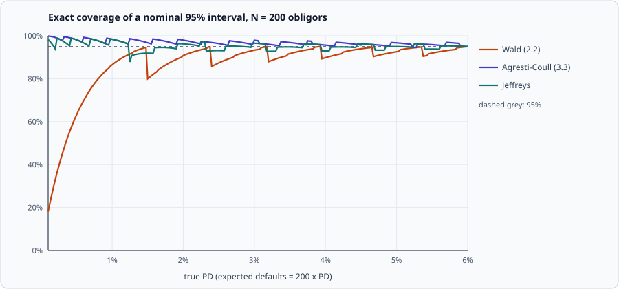

# 04. Intervals for a PD by grade, and mobility

`riskvalidation.transitions.intervals`: `pd_wald`, `pd_agresti_coull`, `effective_n`, `pd_jeffreys`, `pd_bootstrap`, `INTERVALS` (the analytical intervals `exact_coverage` and `overlap_probability` enumerate: Wald, Agresti-Coull, Jeffreys);
`riskvalidation.transitions.mobility`: `svd_mobility`, `trace_mobility`

A PD by grade is a ratio of rare events, and the question a validator asks of it, whether two adjacent grades differ or
whether a grade's PD moved, is a question about its interval. The source for this page is Schuermann and Hanson,
*Estimating probabilities of default*, Federal Reserve Bank of New York Staff Report 190 (2004; published as Hanson
and Schuermann, *Confidence intervals for probabilities of default*, Journal of Banking and Finance 30(8), 2281 to
2301, 2006), read at the page images.

## 1. Wald (2.2)

$$CI_W = \widehat{PD}_R \pm \kappa \sqrt{\frac{\widehat{PD}_R (1 - \widehat{PD}_R)}{N^*_R}} \qquad (2.2),$$

$N^*_R$ the firm-years spent in grade $R$ and $\kappa$ the $100(1 - \alpha/2)$th percentile of the standard normal.
"Naturally this assumes that $\widehat{PD}_R$ is estimated from a set of iid draws ... This clearly seems unreasonable
as there are likely to be common factors such as the state of the economy which affect all firms ... For this reason
the Wald confidence interval described by (2.2) will likely be too tight." Their rule of thumb is
$\widehat{PD}_R N^*_R \ge 10$: a 10bp PD needs some 10,000 firm-years. `pd_wald(defaults, n)` returns the interval
bounded to $[0, 1]$ (as their Table 5 prints it) and whether the rule of thumb holds; it is vectorised over grades.

## 2. Agresti-Coull (3.2), (3.3), and dependence (3.4)

Citing Brown, Cai and DasGupta (2001) on the Wald interval's poor coverage "not just for cases when the true (but
unknown) probability is near the 0,1 boundary but throughout the unit interval", Schuermann and Hanson give the
Agresti-Coull interval (Agresti and Coull 1998, The American Statistician 52, 119 to 126):

$$\widetilde{PD}_R = \frac{\tilde N_{R,D}}{\tilde N_R}, \quad \tilde N_{R,D} = N_{R,D} + \kappa^2/2, \quad
\tilde N_R = N_R + \kappa^2 \quad (3.2), \qquad CI_{AC} = \widetilde{PD}_R \pm \kappa
\sqrt{\frac{\widetilde{PD}_R (1 - \widetilde{PD}_R)}{\tilde N_R}} \quad (3.3),$$

"add 2 successes and 2 failures" when $\kappa$ is rounded to 2. For correlated defaults they give the correction of
Miao and Gastwirth (2004, The American Statistician 58, 124 to 130), an effective number of observations

$$N^\dagger_R = \Big[\frac{1}{N_R} + \frac{2}{N_R^2} \sum_{i < j} \sqrt{N_{i,R} N_{j,R}}\, \rho_{ij}\Big]^{-1}
\qquad (3.4),$$

$N_{i,R}$ the trials (years) of obligor $i$ in grade $R$ and $\rho_{ij}$ the default correlation, which replaces $N_R$
in (2.2) and (3.2); the Agresti-Coull centre becomes $(\widehat{PD}_R N^\dagger_R + \kappa^2/2)/(N^\dagger_R +
\kappa^2)$. With one trial per obligor and one $\rho$, $N^\dagger = N/(1 + (N - 1)\rho)$: 531 obligors at $\rho$ = 1%
count as 84. `effective_n(n, rho, trials)` computes (3.4); `pd_wald` and `pd_agresti_coull` take `rho` and `trials`.

**Table 5, reproduced.** Their Table 5 prints the intervals for BB in 2002 by the cohort method, 531 obligors, in basis
points. The count of defaults is not printed; 15 is the one count that gives every printed bound, and with it the
engine reproduces all twelve analytical bounds and lengths to the printed digits
(`tests/test_reproductions.py::test_schuermann_hanson_table5`):

| | independent ($N$ = 531) | $\rho$ = 1% ($N^\dagger$ = 84.3) | $\rho$ = 2% ($N^\dagger$ = 45.8) |
|---|---|---|---|
| Wald | (141.56, 423.41), length 281.84 | (0.00, 636.20), 636.20 | (0.00, 762.45), 762.45 |
| Agresti-Coull | (168.03, 464.71), 296.68 | (38.25, 938.00), 899.75 | (0.00, 1,332.56), 1,332.56 |

"Even a modest default correlation of 1% can have a dramatic impact on the effective confidence interval": the Wald
interval more than doubles and the Agresti-Coull interval triples. Their bootstrap row (150.09, 433.92) needs their
data and is not reproduced.

## 3. Jeffreys

The equal-tailed interval of the posterior under the Jeffreys prior, $\text{Beta}(D + 1/2, N - D + 1/2)$, with the
lower bound set to 0 when $D = 0$ and the upper bound to 1 when $D = N$ (Brown, Cai and DasGupta 2001,
[doi:10.1214/ss/1009213286](https://doi.org/10.1214/ss/1009213286), as defined in Zhou, Li and Yang 2008,
[doi:10.1098/rsta.2008.0037](https://doi.org/10.1098/rsta.2008.0037), Appendix C). Its posterior is the one the
ECB's Jeffreys test (`pd.jeffreys`, [PD calibration](../tests/01_pd-calibration.md)) reads. `pd_jeffreys(defaults, n)`.

## 4. Exact coverage

The coverage of an interval for a binomial count is a finite sum, so it is computed exactly, not simulated: for $N$
obligors and a true PD $p$, $C(p) = \sum_{d=0}^{N} \binom{N}{d} p^d (1 - p)^{N - d}\, 1\{p \in CI(d)\}$.

Exact coverage of the nominal 95% intervals (`tests/test_transitions.py::test_pd_intervals`, to four digits):

| Obligors | true PD | expected defaults | Wald | Agresti-Coull | Jeffreys |
|---|---|---|---|---|---|
| 200 | 0.5% | 1 | 63.25% | 98.13% | 98.13% |
| 1,000 | 2% | 20 | 94.97% | 94.67% | 95.89% |

With one expected default the Wald interval covers 63% of the time: at no default it collapses to $[0, 0]$, which
happens with probability $(1 - p)^N \approx e^{-1}$. The best grades of a CEREP cohort are often that case, and so
is every low-default portfolio. Agresti-Coull and Jeffreys hold near their level across the range, with the sawtooth a
discrete count imposes. None of the three accounts for default correlation; (3.4) does, given a $\rho$.

`exact_coverage(method, n, pd, level=0.95)` computes the sum above and the expected length $\sum_d \Pr(d)\,|CI(d)|$
for one or many true PDs, for `"wald"`, `"agresti_coull"` or `"jeffreys"` (independent defaults: the count is
binomial). Whether two adjacent grades can be told apart is the same kind of sum over two independent counts:

$$\Pr[\text{overlap}] = \sum_{d_a=0}^{N_a} \sum_{d_b=0}^{N_b} \Pr(d_a)\Pr(d_b)\,
1\{L(d_a) \le U(d_b),\ L(d_b) \le U(d_a)\},$$

`overlap_probability(method, n, pd_a, pd_b, n_b=None, level=0.95)`. At 1,000 obligors per grade the Jeffreys intervals
of PDs of 2bp and 5bp overlap with probability above 0.99: Schuermann and Hanson's finding that "it is impossible to
distinguish notch-level PDs for investment grade ratings" is a property of the counts, before any data.

## 5. Bootstrap of the duration PD

"As it is not clear how to obtain asymptotic expressions for $\widehat{PD}_R$ obtained via the duration or hazard
approach, this is our preferred method for constructing confidence intervals for these estimates. By resampling on the
rating histories, we create $B$ bootstrap samples of size $N_t$ each ... compute the entire migration matrix ... and
then focus our attention just on the last vector" (section 2.3), with $B$ = 10,000 (Efron and Tibshirani suggest 1,000
for intervals). The parametric alternative of Christensen, Hansen and Lando (2004, Journal of Banking and Finance 28(11),
2575 to 2602, [doi:10.1016/j.jbankfin.2004.06.003](https://doi.org/10.1016/j.jbankfin.2004.06.003)), as Schuermann and
Hanson describe it: "estimate an intensity based migration matrix using all the available data and then generate many,
say $B^*$, synthetic rating histories from that estimated migration matrix ... compute $B^*$ intensity based migration
matrices and thus are able to compute a simulation-based confidence interval from the default columns".

`pd_bootstrap(paths, n_states, method="resample" | "parametric", horizon, n_boot, seed)` gives percentile intervals
for $[\exp(t\hat Q)]_{i,D}$ by grade, with the bootstrap standard error; the parametric one starts every obligor in its
first observed state and simulates over the observation window with the
[rating-path generator](../generators/05_rating-paths.md). On 2,000 obligors per grade over three years of the size
study's chain, 200 replicates each, both cover the true one-year PD of every grade and their standard errors agree
within 30% (RV-409's test). Their findings, from the abstract: bootstrapped intervals for duration PDs are
"surprisingly tight when compared with the more commonly used (asymptotic) Wald interval", and "it is impossible to
distinguish notch-level PDs for investment grade ratings ... However, once the speculative grade barrier is crossed, we
are able to distinguish quite cleanly notch-level estimated default probabilities". Whether that holds at CEREP's cohort
sizes is measured in the Contraste case C04 (finding F-NOTCH).

## 6. Mobility

Jafry and Schuermann, *Measurement, estimation and comparison of credit migration matrices*, Journal of Banking and
Finance 28(11), 2603 to 2639 (2004), [doi:10.1016/j.jbankfin.2004.06.004](https://doi.org/10.1016/j.jbankfin.2004.06.004)
(closed access; read at the abstract of their working paper): subtract the identity, take the singular values and
average them, "a metric which has an intuitively-appealing 'size' related to the average probability of migration",
chosen to be "distribution discriminatory, i.e. sensitive to the distribution of off-diagonal probability mass":

$$M_{SVD}(P) = \frac{1}{n} \sum_{i=1}^{n} \sigma_i(P - I).$$

The classical comparator, which the literature attributes to Shorrocks (1978, Econometrica 46(5); not read here,
UNVERIFIED), is the trace index $(n - \operatorname{tr} P)/(n - 1)$. Both are zero on the identity. On two states
$P - I$ has rank one and $M_{SVD} = \sqrt{2(a^2 + b^2)}/2$ for off-diagonal probabilities $a$ and $b$, while the
trace index is $a + b$. The trace index sees only the diagonal: with seven grades that each keep 0.9, a matrix moving
the other 0.1 one notch and one spreading it evenly over the other six grades have the same trace index (0.1167) and
different $M_{SVD}$ (0.1206 and 0.1000). $M_{SVD}$ is not a distance in notches either: moving the 0.1 one notch or
five notches along a cycle gives the same singular values (`tests/test_transitions.py::test_mobility`).

The EBA guidelines tie mobility to the rating philosophy (EBA/GL/2017/16, paragraph 66(c)): "migrations among grades
will be more likely in rating systems which are more sensitive to economic conditions", while systems "less sensitive
to economic conditions tend to estimate PDs that are closer to the average PD across the various states of the
economy, but that differ from observed default rates in years where the state of the economy is above or below its
average". Mobility by year against the cycle is how a validator reads a rating philosophy off a migration history;
paragraph 67 asks institutions to analyse "migration across grades or pools" and "changes in the yearly default rates
of each grade or pool".
