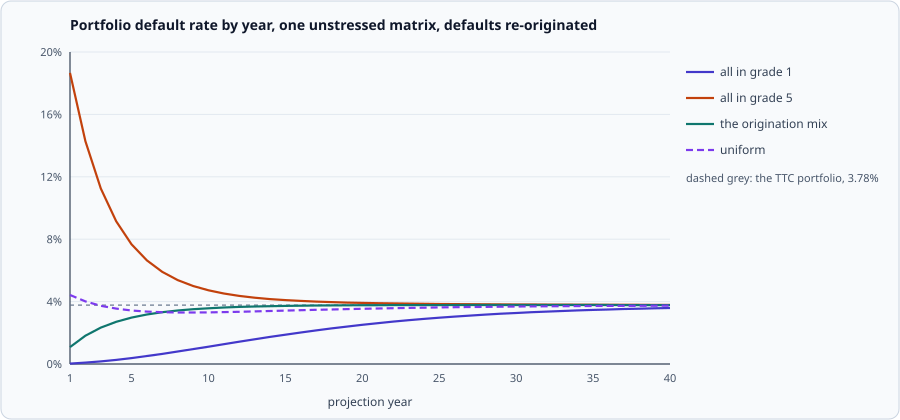

# 05. The through-the-cycle portfolio a migration matrix implies

`riskvalidation.transitions.ttc`: `ttc_portfolio`, `project`, `propagation_matrix`, `is_primitive`

## 1. The propagation

B. Engelmann, *Spurious default probability projections in credit risk stress testing models*, arXiv 2401.08892v1
(2024), read in full. A credit risk stress test projects a bank's portfolio over several years with a transition
matrix: the TTC matrix $T$, stressed each year into $T(z_t)$ by the state of the economy $z_t$ from a macroeconomic
model. The paper's model structure: a portfolio over $n$ grades with default last,
$W = (w_1, \dots, w_n)$, $\sum_i w_i = 1$; an origination vector $O$, $\sum_i o_i = 1$; and, each period, "The
defaulted part of the portfolio after migration $w_{t,n}$ is immediately written off and replaced by new origination
of exactly the defaulted amount to keep total loan balance constant over time". In matrix form,

$$W'_t = W'_{t-1} T(z_t) I_w + \big(W'_{t-1} T(z_t) V_w\big) O' \qquad (9),$$

with $I_w$ the identity whose last diagonal entry is 0 (the write-off) and $V_w = (0, \dots, 0, 1)'$ (the defaulted
balance, re-originated by $O$). The portfolio PD is $\sum_i w_i T_{in}$.

## 2. Theorem 1: a portfolio of the matrix's own

"If the following two conditions 1. The sub-matrix of transitions between performing rating grades $T_p = (p_{i,j})$,
$i, j = 1, \dots, n - 1$ is primitive, i.e., there exists a positive integer $k_p$ such that all entries of $T_p^k$ are
strictly positive $\forall k \ge k_p$ 2. There is no origination into the default class, i.e., $o_n = 0$ are
fulfilled, then there exists a unique portfolio $W_{ttc}$ with

$$W'_{ttc} = W'_{ttc} T I_w + (W'_{ttc} T V_w) O' \qquad (10).$$

The TTC portfolio $W_{ttc}$ can be calculated by the algorithm $W_0 = W_{init}$, $W'_t = W'_{t-1} T I_w +
(W'_{t-1} T V_w) O'$, $t = 1, 2, \dots$ for an arbitrary initial portfolio $W_{init}$." The proof applies
Perron-Frobenius to $M = T I_w + T V_w O'$. The abstract states the consequence: "the model parameterization implies a
unique through-the-cycle portfolio which is unrelated to a bank's current portfolio. Independent of the stress imposed
to the model, the current portfolio will have a tendency to propagate towards the through-the-cycle portfolio. This
could create unwanted spurious effects on projected portfolio default rates especially when a stress test model's
parameterization is inconsistent with a bank's current portfolio."

The conditions are checked, not assumed. Primitivity by Wielandt's bound: a non-negative $k \times k$ matrix is
primitive if and only if its $((k - 1)^2 + 1)$-th power is strictly positive (`is_primitive`). The paper's own
counterexample, $T_p = \begin{pmatrix} 0 & 1 \\ 1 & 0 \end{pmatrix}$, where "the portfolio switches each year between
rating grades 1 and 2 without converging", is refused, and so is an origination into default.

`ttc_portfolio(T, O)` iterates (9) with the unstressed $T$ from the uniform performing portfolio until the L1 change is
below $10^{-14}$, and checks the result against the Perron vector of $M$. `project(T, W0, O, years)` propagates a
starting portfolio, with one matrix (the unstressed projection, which also returns the TTC portfolio and each year's
distance to it) or one matrix per year (a stressed path), and returns the portfolio and the portfolio PD of every year.

## 3. Section 4, reproduced

The paper's example is the matrix (11) of Trueck and Rachev (2009, page 3), seven grades and default, with
$O$ = (0.00, 0.20, 0.30, 0.30, 0.20, 0.00, 0.00, 0.00). `tests/test_reproductions.py::test_engelmann_ttc_portfolio`
reads the matrix from the paper (a rating agency's data reprinted there, so the paper is read from the device data root
`RISKVALIDATION_DATA/engelmann-2024/2401.08892v1.pdf` and the test skips without it) and reproduces every printed
number:

| Printed in section 4 | The engine |
|---|---|
| $W_{ttc}$ = (0.0183, 0.1423, 0.3379, 0.2633, 0.1321, 0.0911, 0.0150, 0), "TTC PD is 1.198%" | the same to four decimals; 1.198% |
| $W_{init}$ = (0.00, 0.00, 0.20, 0.40, 0.30, 0.10, 0.00, 0.00), "portfolio PD is 1.161%" | 1.161% |
| $W_{init}$ = (0.70, 0, 0, 0, 0, 0.25, 0.05, 0), PD 2.725%, "reaches a minimum average PD of 0.722%" over 50 years | 2.7245%; minimum 0.7222% |
| $\widetilde W$ = (0.01, 0.02, 0.10, 0.30, 0.41, 0.15, 0.01, 0.00), PD 1.83%, "moves up to a maximum of 2.14%" | 1.8272%; maximum 2.1396% |

**A printed matrix's rounding.** The rows of (11) sum to 1 only up to their four-digit rounding (1.0001 and 0.9999
occur). The module uses a printed matrix as printed, refusing rows off by more than `atol` ($10^{-3}$), and keeps the
balance at one by rescaling the portfolio after each period, which is the paper's own step 5 ("to keep total loan
balance constant over time"). That reproduces the table above. Renormalising the rows of $T$ instead moves two entries
of the TTC portfolio by 0.0002 (0.3377 and 0.0912 against the printed 0.3379 and 0.0911), and the minimum of the second
projection to 0.723%: the paper computed with the matrix as printed.

## 4. The drift without a scenario

On the size study's generator (the one-year matrix $\exp(Q)$ of five grades and default, origination 30%, 40% and 30%
into grades 2 to 4), four starting portfolios projected with the same unstressed matrix: every path converges to the
TTC default rate of 3.78%, a portfolio concentrated in the best grade rising from almost nothing over decades and one
concentrated in the worst falling from 18.7%, and the uniform portfolio dips below the TTC rate before rising to it.
None of that movement comes from a scenario. In Engelmann's words, "the stress test could signal a recession or a boom
which is not contained in the model but entirely an effect stemming from inconsistent model parameters", and the
effect "could be visible already in the first year of a stress test". His recommendation: "the TTC portfolio $W_{ttc}$
should be computed and compared with the current portfolio. Furthermore, projecting the current portfolio without
stress and computing average PDs gives an indication whether a stress test might result in a spurious recession or
underestimate the effects of a recession scenario."

For the validator this is a test of a stress-test or IFRS 9 projection that needs no data beyond the model's own
parameters and the bank's current portfolio: compute $W_{ttc}$, compare it with the portfolio, and project without
stress. A large gap, or a non-monotone unstressed path, means part of every stressed projection is the matrix's drift.
The Contraste case C04 does it live on the agencies' published matrices (finding F-TTC-DRIFT).

`tests/test_transitions.py::test_ttc_portfolio` (RV-411) checks the closed form on two grades (the TTC share of the
first grade is the balance of flows between the two), the fixed point $W'_{ttc} M = W'_{ttc}$, the convergence from
opposite starts within $10^{-9}$ in 300 years, a stressed path, and the refusals.
